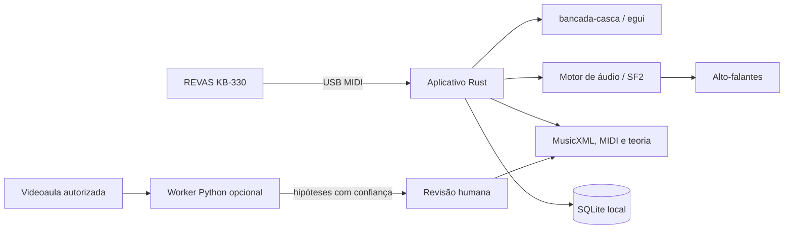

# Piano Tutor 🎹

**Um professor assistido de piano e teclado, local-first, construído em Rust.**

[Especificação integral](docs/specs/ESPECIFICACAO-COMPLETA-v1.md) · [Fases e aceites](docs/aceite/MATRIZ-DE-ACEITE.md) · [Arquitetura](docs/arquitetura/README.md) · [Como trabalhar com agentes](AGENTS.md)

## Visão

O projeto evolui do espelho MIDI das 61 teclas do **REVAS KB-330** para instrumento virtual SoundFont, exercícios musicais, leitura/edição de partituras MusicXML, gravação MIDI, metrônomo, bateria, pads e, por último, uma **Fábrica de Lições** que extrai rascunhos revisáveis de videoaulas (áudio + fala + visão superior das teclas e mãos).

**Regra:** nada de construir quinze módulos ao mesmo tempo. Entregamos **uma fase demonstrável por vez**, com testes, evidência e aceite humano antes da seguinte.

## Arquitetura-alvo



A IA **não** entra no caminho crítico MIDI → áudio. O aplicativo deve tocar normalmente quando Python, modelos e rede não estiverem disponíveis. Luau (`mlua`) é uma possibilidade *posterior* para regras pedagógicas limitadas, não o motor inicial de ML.

## Primeiras entregas

| Marco | Fases (ordem de execução) | Demonstração de aceite |
|---|---|---|
| M1 — Tocar com som | F00 → F01 → F02 → F03 | Instalar o `.deb`, ligar o REVAS, ver as 61 teclas acendendo e ouvir piano e um segundo timbre com p95 ≤ 50 ms |
| M2 — O app ensina | F04 → F08 → F06 → F05 | Exercício com metrônomo, feedback com compasso e replay da Gravação |
| M3 — Ler e ritmo | spike de notação → F07 → F09 | MusicXML licenciado em duas claves, playback e pads |
| M4 — Fábrica de Lições | F10 → F11 → F12 → F13 | Aula local → Hipóteses → revisão → Lição → "Praticar este trecho" |
| M5 — Homologação | F14 | 60 min de uso real, `.deb` limpo sem Python, checklist assinado |

Detalhes em [PLANO-DE-MARCOS.md](docs/planejamento/PLANO-DE-MARCOS.md); vocabulário em [CONTEXT.md](CONTEXT.md). A plataforma única da v1 é **Linux** ([ADR-0004](docs/decisoes/ADR-0004-somente-linux.md)).

[Abra a matriz F00–F14](docs/aceite/MATRIZ-DE-ACEITE.md) para os critérios detalhados.

## Estado real deste repositório

App Rust funcionando no Linux, **ainda sem homologação com o REVAS** (gates de hardware NÃO VERIFICADOS). Existe: Monitor MIDI, Espelho de 61 teclas, som SoundFont (FluidR3) com divisão/camada/transposição, calibração do teclado, acordes e escalas, ritmos (metrônomo, bateria de passos, pads). Gravação (F06) e exercícios (F05) em andamento. Partitura (F07) e IA (F10–F13) ainda não existem.

## Organização

- `docs/specs/`: especificação canônica consolidada (1.0).
- `backlog/fases/`: 15 fichas executáveis, cada uma com seus critérios de aceite.
- `docs/aceite/`: matriz e regras de homologação.
- `docs/arquitetura/` e `docs/decisoes/`: arquitetura e ADRs iniciais.
- `docs/skills/`: política de skills; 8 skills Matt Pocock versionadas em `.agents/skills/` (Codex) e `.claude/skills/` (Claude Code).
- `.github/agents/`, `.claude/agents/`, `AGENTS.md`: instruções dos agentes.
- `crates/piano-tutor-core`: núcleo puro (MIDI, teclado, teoria, ritmo), sem hardware nem áudio.
- `crates/piano-tutor-{midi,audio,app,diag}`: MIDI (midir/ALSA), áudio (cpal + rustysynth), app e diagnóstico.
- `scripts/`: verificação, preparação da equipe, publicação e geração de issues.

## Começar no Linux (cerebro)

A v1 é desenvolvida e homologada **somente em Linux**, no PC de referência **cerebro** (Kubuntu 26.04), com o REVAS em USB nativo (ALSA/PipeWire) e áudio onboard via PipeWire.

```bash
# Pré-requisitos do sistema (apt, PipeWire e rustup):
./scripts/bootstrap-linux.sh        # checar (não instala nada)
./scripts/bootstrap-linux.sh --sim  # instalar pacotes via apt

# Com Rust/Cargo instalado:
cargo fmt --all --check
cargo clippy --workspace --all-targets -- -D warnings
cargo test --workspace

# As oito skills fundamentais já estão versionadas. Para instalar outras do upstream (opcional):
./scripts/instalar-skills.sh
```

**Publicação:** este repositório já foi inicializado diretamente na `main`, com as 15 issues F00–F14 abertas para acompanhamento. As skills essenciais foram incorporadas e versionadas diretamente do repositório de Matt Pocock, com licença MIT preservada e revisão de origem fixa. Os scripts `instalar-skills` permitem atualizar ou acrescentar outras skills via `npx` (ação opcional não executada aqui). Os scripts `publicar-github` agora fazem apenas sincronização segura, nunca force-push.

**Visibilidade atual:** o GitHub indica que este repositório está **público**. Não adicionar cursos, mídia protegida, segredos ou dados pessoais; se desejar projeto privado, alterar a visibilidade nas configurações do repositório.

A shell reutilizável é [`ChicoFigueiredo/bancada`](https://github.com/ChicoFigueiredo/bancada), `crates/bancada-casca`, e **será pública (MIT OR Apache-2.0)** — *pendência do titular:* mudar a visibilidade e a licença no repositório `bancada`; só então a CI compila sem credencial. A integração real será implementada em F00/F02, com dependência fixada. Não copiar código de Chess Studio para criar uma segunda shell.

## Rodar no cerebro (Linux)

### 1. Pegar a versão mais recente

O trabalho em andamento fica em branches `claude/project-thread-*` até virar PR. Para testar a versão mais nova, atualize e troque para a branch indicada na thread (hoje, `claude/project-thread-wel6ol`, que empilha Ribbon, dedilhado, exercícios TOML, treino de acordes e o progresso da homologação):

```bash
git fetch origin
git switch claude/project-thread-wel6ol
git pull --ff-only
```

### 2. Compilar e abrir

A partir da raiz do repositório (a primeira compilação leva alguns minutos; as seguintes, segundos):

```bash
cargo build --release
./target/release/piano-tutor-app
```

Se ainda não tiver Rust, rode antes `./scripts/bootstrap-linux.sh` (só confere) ou `./scripts/bootstrap-linux.sh --sim` (instala via apt).

**SoundFont:** não é preciso instalar nada. Se o app não achar um `FluidR3_GM.sf2` no sistema, ele baixa o FluidR3_GM (licença MIT) da release do repositório na primeira execução, confere o SHA-256 e guarda em `~/.local/share/piano-tutor/`. O progresso aparece na tela Sons e timbres. Para usar o pacote do Debian em vez do download: `sudo apt install fluid-soundfont-gm`.

Para gerar o relatório de diagnóstico do equipamento, use o rótulo do PC:

```bash
./target/release/piano-tutor-diag --rotulo cerebro
```

### 3. Ligar o REVAS KB-330

1. Ligue o teclado e conecte o USB direto no PC (evite hub; use cabo de dados, não só de carga).
2. Confira que o Linux o enxerga: `amidi -l` e `aconnect -l` devem listar o KB-330. Se nem `lsusb` mostrar o aparelho, o problema é cabo, porta ou energia, não o app.
3. No app, abra **Monitor MIDI**, escolha a porta do REVAS e clique em conectar.

**Porta ocupada ou conexão que falha:** feche instâncias antigas do Piano Tutor (`pgrep -af piano-tutor`, depois `pkill -f piano-tutor-app`) e outros programas MIDI (DAW, VMPK, navegador com Web MIDI) e conecte de novo.

O roteiro completo do que testar com o teclado e onde registrar cada resultado está em [TESTES-COM-HARDWARE.md](docs/planejamento/TESTES-COM-HARDWARE.md).

Guia rápido das telas (menu lateral e Ribbon):

- **Monitor MIDI**: escolha a porta do REVAS e clique em conectar. Mostra os eventos recebidos, o que o dispositivo transmite (o que não transmite aparece como "não suportado pelo dispositivo") e o log da sessão.
- **Calibrar teclado**: percorra as 61 teclas, velocity e pedal. Ao final grava `teclado.txt` e o relatório `rev-as-calibracao.md` em `~/.local/share/piano-tutor/`.
- **Teclado de 61 teclas**: espelho virtual das teclas. Sem o REVAS conectado, funciona em simulação com o mouse e o teclado do PC.
- **Acordes e escalas**: nome do acorde ao vivo, dicionário com inversões, escalas, campo harmônico e desafio de acordes (inclui o modo de ouvido).
- **Ritmos**: metrônomo de 40 a 220 bpm, compassos 2/4, 3/4, 4/4, 6/8 e 12/8, subdivisões, contagem inicial e tap tempo; bateria de 16 passos com 11 padrões prontos; 8 pads nas teclas 1 a 8; exercício "toque no pulso".
- **Sons e timbres**: SoundFont, timbres favoritos, divisão e camada do teclado, transposição, reverb e chorus. As preferências são salvas automaticamente.
- **Perfil** (Início > Perfil): as preferências ficam no banco `~/.local/share/piano-tutor/piano-tutor.sqlite`, por perfil. "De fábrica" devolve tudo ao padrão e nunca muda; mexer em algo com ele ativo cria "Meu perfil" ([ADR-0010](docs/decisoes/ADR-0010-preferencias-em-sqlite-com-perfis.md)).
- **Conexão automática**: depois da calibração, o app conecta sozinho no teclado ao abrir e quando ele é plugado no USB.
- **Pânico (Ctrl+.)**: corta todo o som na hora, de qualquer tela.

Gravação e Exercícios estão em andamento.

## Licenciamento, privacidade e segurança

Projeto **sem licença aberta atribuída**, com repositório atualmente público; código autoral não recebe licença de terceiros automaticamente. Sem licença aberta atribuída ao código do novo aplicativo até decisão explícita do titular. Bibliotecas e modelos têm **licenças próprias**; não subir vídeos comprados, SoundFonts de terceiros, pesos restritos, chaves, datasets pessoais ou gravações sem permissão. Consulte [Política de conteúdo e dependências](docs/seguranca/LICENCAS-E-DADOS.md).