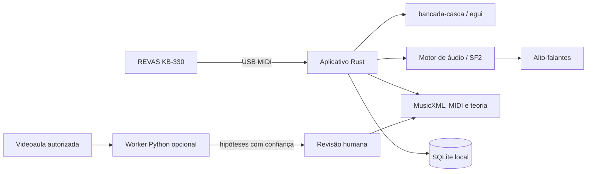

# Piano Tutor 🎹

**Um professor assistido de piano e teclado, local-first, construído em Rust.**

[Especificação integral](docs/specs/ESPECIFICACAO-COMPLETA-v1.md) · [Fases e aceites](docs/aceite/MATRIZ-DE-ACEITE.md) · [Arquitetura](docs/arquitetura/README.md) · [Como trabalhar com agentes](AGENTS.md)

## Visão

O projeto evolui do espelho MIDI das 61 teclas do **REVAS KB-330** para instrumento virtual SoundFont, exercícios musicais, leitura/edição de partituras MusicXML, gravação MIDI, metrônomo, bateria, pads e, por último, uma **Fábrica de Lições** que extrai rascunhos revisáveis de videoaulas (áudio + fala + visão superior das teclas e mãos).

**Regra:** nada de construir quinze módulos ao mesmo tempo. Entregamos **uma fase demonstrável por vez**, com testes, evidência e aceite humano antes da seguinte.

## Arquitetura-alvo



A IA **não** entra no caminho crítico MIDI → áudio. O aplicativo deve tocar normalmente quando Python, modelos e rede não estiverem disponíveis. Luau (`mlua`) é uma possibilidade *posterior* para regras pedagógicas limitadas, não o motor inicial de ML.

## Primeiras entregas

| Sequência | Evidência exigida |
|---|---|
| F00 — Laboratório | Workspace, biblioteca `bancada-casca` validada, diagnósticos e ambiente documentados |
| F01 — MIDI real | Eventos do REVAS detectados, calibração das 61 teclas, teste físico |
| F02 — Espelho visual | Tecla pressionada acende e apaga corretamente, inclusive acordes |
| F03 — SoundFont | Mesmo Dó com dois timbres, latência medida, sem estalos |
| F04–F09 | Teoria, exercícios, gravação, partituras, metrônomo, bateria/pads |
| F10–F13 | Vídeo, IA multimodal e lições revisáveis |
| F14 | Homologação, empacotamento, documentação e distribuição |

[Abra a matriz F00–F14](docs/aceite/MATRIZ-DE-ACEITE.md) para os critérios detalhados.

## Estado real deste repositório

**Repositório de planejamento e bootstrap.** Os documentos e uma crate de domínio mínima estão prontos. **Não** afirmar que já existe conexão MIDI, sintetizador, interface final, partitura ou IA funcionando; isso só ocorre mediante implementação e homologação de cada fase.

## Organização

- `docs/specs/`: especificação canônica consolidada (1.0).
- `backlog/fases/`: 15 fichas executáveis, cada uma com seus critérios de aceite.
- `docs/aceite/`: matriz e regras de homologação.
- `docs/arquitetura/` e `docs/decisoes/`: arquitetura e ADRs iniciais.
- `docs/skills/`: seleção, política e instalação das skills Matt Pocock.
- `.github/agents/`, `.claude/agents/`, `AGENTS.md`: instruções dos agentes.
- `crates/piano-tutor-core`: primeiro núcleo puro em Rust, **sem hardware nem áudio**.
- `scripts/`: verificação, preparação da equipe, publicação e geração de issues.

## Começar no Windows ou WSL2

O REVAS deve ser testado inicialmente no **Windows nativo**, onde a conexão USB é direta. O WSL2 pode ser usado para editor, análise e desenvolvimento, mas MIDI USB precisa ser testado no SO em que o dispositivo está efetivamente exposto.

```bash
# Com Rust/Cargo instalado:
cargo fmt --all --check
cargo clippy --workspace --all-targets -- -D warnings
cargo test --workspace

# Instala as skills no repositório, quando houver Internet:
./scripts/instalar-skills.sh
```

Para criar automaticamente o repositório **privado** e publicar todos os arquivos na `main`, use `./scripts/publicar-github.sh` (Linux/WSL2) ou `./scripts/publicar-github.ps1` (PowerShell), após instalar GitHub CLI e autenticar com `gh auth login`. O script instala as skills via `npx` e cria as 15 issues correspondentes às fases. Não força push nem reescreve commits remotos.

A shell reutilizável é **privada**: [`ChicoFigueiredo/bancada`](https://github.com/ChicoFigueiredo/bancada), `crates/bancada-casca`; a integração real será implementada em F00/F02, com dependência fixada e política de acesso da CI. Não copiar código de Chess Studio para criar uma segunda shell.

## Licenciamento, privacidade e segurança

Projeto inicialmente **privado**, sem licença aberta atribuída ao código do novo aplicativo até decisão explícita do titular. Bibliotecas e modelos têm **licenças próprias**; não subir vídeos comprados, SoundFonts de terceiros, pesos restritos, chaves, datasets pessoais ou gravações sem permissão. Consulte [Política de conteúdo e dependências](docs/seguranca/LICENCAS-E-DADOS.md).