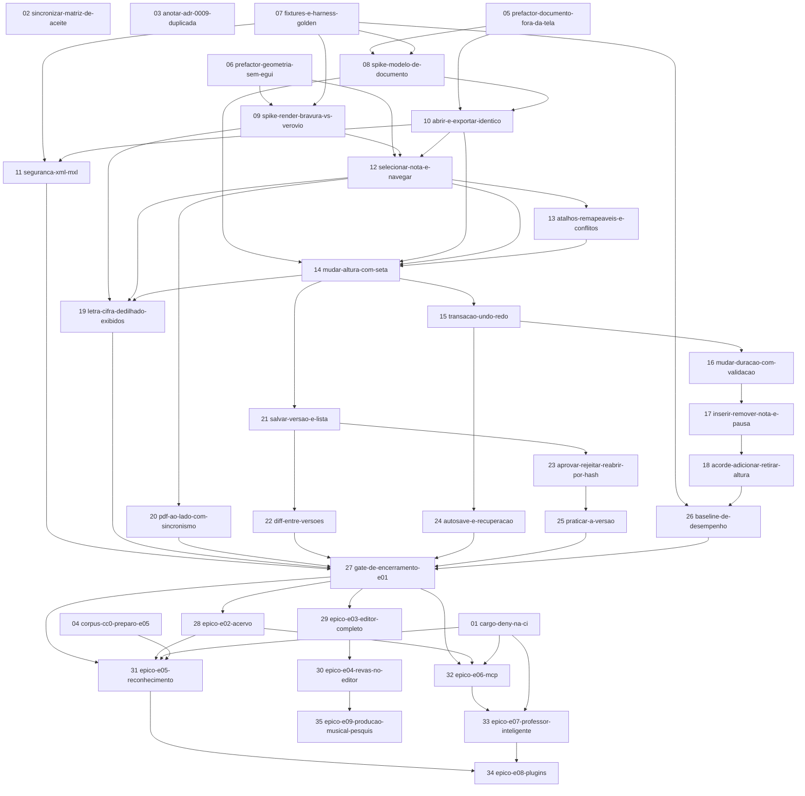

# Backlog da evolução musical (E00 → E09)

Gerado na E00, etapa to-tickets, a partir de [ESPECIFICACAO-EVOLUCAO-MUSICAL](../../docs/specs/ESPECIFICACAO-EVOLUCAO-MUSICAL.md). Um arquivo por ticket, numerado em ordem de dependência (bloqueadores primeiro). Tickets de E01 são fatias verticais (tracer bullet); E02–E09 são um ticket-épico por fase, a ser quebrado quando seus bloqueios fecharem. Estes tickets são independentes das fichas Fxx de `backlog/fases/`.

Regras: uma fase por vez; o aceite da fase é humano; o que depende de REVAS, áudio real ou macOS fica NÃO VERIFICADO até medição no PC de referência. O modelo/effort é sugestão do planejamento; o Opus orquestrador confirma ou muda ao despachar (docs/equipe/WORKFLOW.md) e registra o motivo no ticket.

## Tabela

| NN | Título | Fase | Bloqueado por | Modelo sugerido |
|---|---|---|---|---|
| [01](01-cargo-deny-na-ci.md) | Auditoria de dependências e licenças com cargo deny na CI | Infra | nenhum | Sonnet / médio |
| [02](02-sincronizar-matriz-de-aceite.md) | Sincronizar a MATRIZ-DE-ACEITE com o progresso.json (só documentação) | Infra | nenhum | Haiku / baixo |
| [03](03-anotar-adr-0009-duplicada.md) | Anotar a ADR-0009 duplicada sem renomear | Infra | nenhum | Haiku / baixo |
| [04](04-corpus-cc0-preparo-e05.md) | Preparo do corpus CC0 para o Reconhecimento (OpenScore Lieder + PDFs e scans degradados) | E05 | nenhum | Sonnet / médio |
| [05](05-prefactor-documento-fora-da-tela.md) | Prefactor: separar o documento da partitura do estado da tela | E01 | nenhum | Sonnet / alto |
| [06](06-prefactor-geometria-sem-egui.md) | Prefactor: geometria do layout sem tipos do egui, com ligação nota a nota | E01 | nenhum | Sonnet / alto |
| [07](07-fixtures-e-harness-golden.md) | Corpus de fixtures da E01 e harness de round-trip e comparação semântica | E01 | nenhum | Sonnet / médio |
| [08](08-spike-modelo-de-documento.md) | Spike: modelo híbrido de documento (IdNota + faixa de bytes), prova A1/A2 no corpus CC0 | E01 | 05, 07 | Opus / alto |
| [09](09-spike-render-bravura-vs-verovio.md) | Spike: render egui + SMuFL/Bravura contra Verovio como oráculo (fecha a pendência da ADR-0007) | E01 | 06, 07 | Sonnet / alto para implementar |
| [10](10-abrir-e-exportar-identico.md) | Abrir uma partitura na Oficina e exportar idêntico (serviço de documento, 1ª fatia) | E01 | 05, 08 | Opus / médio |
| [11](11-seguranca-xml-mxl.md) | Segurança de XML e MXL na abertura da Oficina (A13) | E01 | 07, 10 | Sonnet / alto |
| [12](12-selecionar-nota-e-navegar.md) | Selecionar nota no render e navegar com setas e Tab, com foco visível | E01 | 06, 09, 10 | Sonnet / médio–alto |
| [13](13-atalhos-remapeaveis-e-conflitos.md) | Perfil mínimo de atalhos remapeáveis, com Pânico e Ctrl+K intactos (A11) | E01 | 12 | Sonnet / médio |
| [14](14-mudar-altura-com-seta.md) | Selecionar nota e mudar a altura com seta (semitom, oitava, escala) | E01 | 08, 10, 12, 13 | Opus / alto |
| [15](15-transacao-undo-redo.md) | Transação com undo/redo por snapshot do compasso (A5) | E01 | 14 | Sonnet / alto |
| [16](16-mudar-duracao-com-validacao.md) | Mudar a duração com 1–9 e ponto, com validação do compasso (A4) | E01 | 15 | Sonnet / alto |
| [17](17-inserir-remover-nota-e-pausa.md) | Inserir nota ou pausa numa posição do compasso e remover nota (vira pausa) | E01 | 16 | Sonnet / alto |
| [18](18-acorde-adicionar-retirar-altura.md) | Acorde: adicionar e retirar alturas de uma nota | E01 | 17 | Sonnet / médio |
| [19](19-letra-cifra-dedilhado-exibidos.md) | Letra, cifra e dedilhado exibidos e preservados, com lista de elementos não suportados | E01 | 09, 12, 14 | Sonnet / alto |
| [20](20-pdf-ao-lado-com-sincronismo.md) | PDF original ao lado, com zoom e rolagem sincronizados por compasso (A17) | E01 | 12 | Sonnet / médio–alto |
| [21](21-salvar-versao-e-lista.md) | Salvar como nova Versão, com nota de motivo, e listar as Versões | E01 | 14 | Sonnet / alto |
| [22](22-diff-entre-versoes.md) | Diff entre duas Versões, por compasso, com antes e depois (A10) | E01 | 21 | Sonnet / médio |
| [23](23-aprovar-rejeitar-reabrir-por-hash.md) | Aprovar, rejeitar e reabrir uma Versão com motivo, ligadas ao hash (A9) | E01 | 21 | Sonnet / médio |
| [24](24-autosave-e-recuperacao.md) | Autosave em intervalos curtos e recuperação após queda (A7) | E01 | 15 | Sonnet / alto |
| [25](25-praticar-a-versao.md) | Praticar a Versão com os Exercícios existentes, e ouvir o compasso editado (A14) | E01 | 23 | Opus / médio |
| [26](26-baseline-de-desempenho.md) | Baseline de desempenho dos comandos numa peça de 100 compassos (A16) | E01 | 07, 18 | Haiku / médio |
| [27](27-gate-de-encerramento-e01.md) | Gate de encerramento da E01: matriz de rastreabilidade, ADRs e demonstração | E01 | 11, 19, 20, 22, 24, 25, 26 | Opus / alto para a revisão e o relatório |
| [28](28-epico-e02-acervo.md) | Épico E02: Acervo | E02 | 27 | Opus / alto para o to-tickets do épico |
| [29](29-epico-e03-editor-completo.md) | Épico E03: Editor completo | E03 | 27 | Opus / alto para o to-tickets do épico |
| [30](30-epico-e04-revas-no-editor.md) | Épico E04: REVAS no editor | E04 | 29 | Opus / alto para o to-tickets do épico |
| [31](31-epico-e05-reconhecimento.md) | Épico E05: Reconhecimento (OMR em processos separados) | E05 | 27, 28, 01, 04 | Opus / alto para o to-tickets do épico |
| [32](32-epico-e06-mcp.md) | Épico E06: MCP | E06 | 27, 28, 01 | Opus / alto para o to-tickets do épico |
| [33](33-epico-e07-professor-inteligente.md) | Épico E07: Professor inteligente | E07 | 32, 01 | Opus / alto para o to-tickets do épico |
| [34](34-epico-e08-plugins.md) | Épico E08: Plugins (Luau assinado; Python isolado) | E08 | 31, 33 | Opus / alto para o to-tickets do épico |
| [35](35-epico-e09-producao-musical-pesquisa.md) | Épico E09: Produção musical (somente pesquisa) | E09 | 30 | Opus / alto para o to-tickets do épico |

Modelo = sugestão (modelo / effort); o motivo e as ressalvas estão em cada ticket.

## Grafo de dependências

Fronteira inicial (sem bloqueio): 01, 02, 03, 04, 05, 06, 07. Cadeia crítica da E01: 05/07 → 08 → 10 → 12/13 → 14 → 15 → 16 → 17 → 18 → 26 → 27; as ramificações 11, 19, 20, 21→22/23/24→25 entram no 27. Sequência dos épicos: 27 → 28/29; 29 → 30 → 35; 27+28+01+04 → 31; 27+28+01 → 32 → 33 (+01); 31+33 → 34.

## Cobertura dos critérios de aceite da E01

| Critério | Ticket(s) |
|---|---|
| A1 | 08 (prova), 10 |
| A2 | 08 (prova), 14 |
| A3 | 14, 19 |
| A4 | 16 (depende de 15) |
| A5 | 15, 17, 18 |
| A6 | 14, 16, 17, 18 (fixtures: 07) |
| A7 | 24 |
| A8 | 21 |
| A9 | 23 |
| A10 | 22 |
| A11 | 13 |
| A12 | 14 (seleção em 12, atalhos em 13) |
| A13 | 11 |
| A14 | 25 |
| A15 | 19 |
| A16 | 26 |
| A17 | 20 |
| A18 | 19 (render: 09) |

Histórias 1–32 da E01: 1–2 (10, 20); 3–4, 28 (12); 5–7 (14); 8–9 (16); 10–11 (17); 12 (18); 13 (15); 14 (24); 15–17 (21); 18 (22); 19–21 (19); 22–23, 25 (23); 24, 26 (25); 27 (26); 29–30 (13); 31 (09); 32 (08).

## Notas e fora deste backlog

- Spike opcional de MCP somente leitura (ganchos) dentro da E01: não incluído; decidir após o 27 (o diff e as Versões já saem com contrato reutilizável).
- Tickets 01 e 04 bloqueiam a E05 (e o 01 também E06/E07) e podem correr desde já em paralelo à E01.
- Numeração de ADR: 0015 e 0016 existem; os ADRs novos dos spikes 08 e 09 tomam a próxima numeração livre (0017 em diante).

## Respostas do supervisor às dúvidas do to-tickets (2026-11-27)

1. Os spikes 08 e 09 geram ADRs novas (0017 em diante); a ADR-0015 só as referencia.
2. Na E01 as Versões ficam no repositório da Oficina atual, com histórico estendido e identificadas por SHA-256; a E02 migra para o Acervo.
3. A17: o mapa compasso→página vem do que a Oficina já tem; sem região mapeada, sincroniza por página.
4. Conversão por MuseScore no ticket 04: NÃO VERIFICADO até rodar no cerebro.
5. `allow_dtd`: provar que nada externo é resolvido ou desligar o DTD, no ticket 11.
6. Ticket 02 para e pergunta se matriz e progresso conflitarem.
