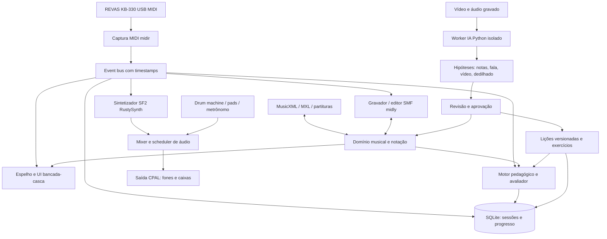

# Piano Tutor — Especificação funcional, arquitetura e plano de experimentos

> **Versão:** 1.0 — 21 de novembro de 2026  
> **Status:** especificação inicial consolidada para execução por equipe/agentes de desenvolvimento; tecnologias candidatas sujeitas a *spikes* e homologação  
> **Plataforma inicial:** Windows 11 nativo; Linux desktop como segunda plataforma  
> **Instrumento de referência:** teclado REVAS KB-330, 61 teclas  
> **Interface compartilhada:** `ChicoFigueiredo/bancada`, crate `bancada-casca`  
> **Modo de desenvolvimento:** **uma fase por vez, com demonstração, teste, evidência e aceite explícito antes de avançar**.

---

## 0. Sumário executivo e princípios

Construir um aplicativo desktop nativo, local-first, em **Rust**, que transforme o teclado físico REVAS KB-330 em um ambiente assistido para estudar piano e teclado. O aplicativo começa **pequeno e funcional** — espelhando teclas via MIDI — e evolui, sem substituição de arquitetura, para sintetizador SoundFont, exercícios, metrônomo, bateria e *sample pads*, partituras MusicXML, gravações MIDI, vídeo-aulas analisadas por IA, extração de notas/ritmos/compassos e criação de lições com revisão humana.

### Resultado final esperado

O usuário conecta o REVAS, escolhe piano ou acordeon, vê as 61 teclas, toca ouvindo o instrumento virtual, acompanha notas e pautas, abre uma música MusicXML (inclusive `.mxl`), pratica com metrônomo e acompanhamento, recebe avaliação objetiva da execução e importa suas próprias videoaulas. A **Fábrica de Lições** transcreve fala, áudio musical e imagem superior do teclado, produz uma **proposta revisável** de lição e permite apertar **“Praticar este trecho”** para tocar junto e comparar via MIDI.

### Princípios não negociáveis

1. **O instrumento ensina desde a primeira entrega.** Nada de construir uma estação de áudio complexa antes de provar a entrada MIDI.
2. **Reutilizar, não clonar:** usar a `bancada-casca`; não criar outro Ribbon e não introduzir GPUI no produto.
3. **Separação de responsabilidades:** apresentação, captura MIDI, motor de áudio, domínio musical, lições, armazenamento e IA independentes.
4. **Precisão antes de automatização:** a IA gera hipóteses com confiança e origem; o sistema não transforma estimativas em fatos confirmados.
5. **Sem IA no caminho crítico de áudio:** tocar uma tecla deve continuar funcionando com o worker Python desligado.
6. **Local-first e offline para tocar/estudar:** Internet só para baixar dependências/modelos, atualizações e operações explicitamente autorizadas.
7. **Formato aberto e interoperável:** MusicXML como representação de partitura; MIDI para eventos/execuções; WAV/FLAC para áudio; MP4/MKV para aula; metadados próprios versionados.
8. **Licenças auditáveis:** licença do código, pesos, SoundFonts, amostras, fontes, videoaulas e partituras verificadas **separadamente**.
9. **Nada de presumir recursos físicos:** conferir no REVAS real quais mensagens MIDI transmite, inclusive velocidade, sustain, octave shift e mudanças de programa.
10. **Nenhuma fase é aceita por aparência ou relato.** Cada fase termina com testes automatizados onde cabível, ensaio manual documentado e um artefato demonstrável.

### Escopo e fronteiras

**Dentro do produto:** espelho 61 teclas, MIDI USB, banco de timbres SF2, ensino básico, pautas e cifras, metrônomo, ritmos, pads, MIDI record/playback, importação/exportação MusicXML, vídeos, IA multimodal com revisão, persistência e indicadores pedagógicos.

**Não obrigatório no primeiro ciclo:** DAW completa, mixagem profissional multifaixa, hospedagem em nuvem, aplicativo mobile, marketplace de timbres, treino de modelo do zero, avaliação objetiva de dedos do **aluno** sem câmera, VST3/CLAP, separação perfeita de qualquer música, reconhecimento 100% de transcrições difíceis.

---

## 1. Descobertas verificadas nos repositórios do usuário

### 1.1 Chess Studio

- Repositório: https://github.com/ChicoFigueiredo/Chess-Studio
- Fonte do Ribbon original: `crates/chess-studio/src/ribbon/{mod.rs,model.rs,view.rs,...}`.
- ADR: `docs/adr/0005-interface-ribbon-acoes-design-system-egui.md`.
- Interface original: `Bevy` + `bevy_egui`, Ribbon em modos clássico/simples/recolhido, lista única de ações, KeyTips, temas, paleta e dock.
- **Conclusão:** serve como origem visual e histórica, **não** deve ser usado como dependência do novo aplicativo.

### 1.2 Biblioteca compartilhada `bancada`

- Repositório: https://github.com/ChicoFigueiredo/bancada
- Crate: `crates/bancada-casca`.
- Manifesto examinado: `egui`/`eframe` **0.36.2**, `egui_tiles` **0.17.1**, `fluent-bundle` **0.16.0**; renderizador `glow` por padrão, alternativa `wgpu`.
- Interface pública em `crates/bancada-casca/src/lib.rs`: `AppCasca`, `Casca`, `ConfigCasca`, `Acao`, `Aba`, `Grupo`, `PainelDock`, temas, ações, navegação, preferências etc.
- Documentação: `crates/bancada-casca/README.md`.
- Demonstração existente: `crates/bancada-casca/examples/demonstracao.rs`.
- Execução documentada: `cargo run -p bancada-casca --example demonstracao`.
- Integração: o novo app implementa `AppCasca`, fornece as ações e páginas e deixa a casca desenhar Ribbon, abas, histórico, dock e status.
- **Conclusão:** biblioteca **já implementada**, não apenas proposta arquitetural; validar compilação no ambiente antes de reutilizar.

### 1.3 Seu Bolso Feliz

- Repositório: https://github.com/ChicoFigueiredo/Seu-Bolso-Feliz
- Decisão: `docs/arquitetura/2026-11-12-adr-018-shell-compartilhada.md`.
- Consumidor de referência: `crates/sbf-janela/src/app.rs` (`impl AppCasca`) e dependência `bancada-casca` em `crates/sbf-janela/Cargo.toml` e `crates/sbf/Cargo.toml`.
- **Conclusão:** copiar o **padrão de integração**, não os recursos financeiros, nem o código-fonte da casca.

### 1.4 Estratégia de dependência

- Desenvolver o Piano Tutor em repositório **separado**, sem alterar Chess Studio nem Seu Bolso Feliz por acidente.
- Na estação de desenvolvimento, aceitar dependência local (`path`) para integração inicial. Para builds reproduzíveis e CI, fixar a biblioteca em **commit SHA** do repositório `bancada`, registrar em lockfile e documentar compatibilidade; a política final de dependências não será uma referência móvel a `main`.
- Não alterar API da `bancada-casca` durante a primeira prova de conceito. Se surgir lacuna, abrir proposta/PR independente com teste de regressão nos consumidores existentes.

---

## 2. Fundamentação musical, formatos e vocabulário

### 2.1 O que é MIDI

MIDI é um protocolo de **eventos musicais**, não um fluxo de som. `Note On` / `Note Off` indicam quais notas começam/terminam; outras mensagens podem informar canal, intensidade (*velocity*), pedal/controladores, mudança de programa, pitch bend etc. A velocidade só é útil se o hardware a transmitir. Os programas/timbres MIDI são uma convenção, **não** equivalem a um arquivo de som.

**Exemplo:** pressionar Dó central normalmente produz nota MIDI 60, reconhecida como **C4** na convenção científica mais comum. Alguns softwares nomeiam oitavas de outro modo; o **número MIDI é a identificação canônica**. A nota 60, em afinação A4=440 Hz, tem frequência fundamental de aproximadamente 261,63 Hz.

Frequência em temperamento igual: `f(n) = 440 * 2^((n-69)/12)` (valor de 440 Hz **configurável**). O mesmo Dó fundamental pode soar como piano ou acordeon graças a amostras, harmônicos, envelopes e articulação diferentes.

**Compasso**: 3/4 não é “três quartos de segundo”; organiza pulsos/figuras. 6/8 costuma ter duas pulsações compostas (duas semínimas pontuadas), mas depende da música. Não reduzir todas as fórmulas de compasso a uma divisão trivial de BPM.

### 2.2 Formatos e usos

| Formato | Papel primário | Observações |
|---|---|---|
| `.mid` — Standard MIDI File | Execução, reprodução, notas/tempos/eventos, gravação | Não preserva necessariamente paginação, claves, vozes, dedilhado ou grafia exata da partitura |
| `.musicxml` / `.xml` | Partitura simbólica intercambiável | Notas, durações escritas, claves, pausas, compassos, articulação e possíveis dedos |
| `.mxl` | MusicXML compactado em ZIP estruturado | Não é MIDI; ler `META-INF/container.xml`, preservar conteúdo e validar limites |
| `.pdf` | Leitura/impressão | Não é fonte estruturada confiável para edição; OMR é tarefa distinta e posterior |
| `.sf2` | Banco SoundFont para sintetizar sons | Não confundir com partitura; programas/presets e bateria |
| `.sfz` + WAV/FLAC | Instrumento amostrado baseado em mapeamento de arquivos | Requer motor SFZ ou conversão apropriada; RustySynth não é motor SFZ |
| `.wav` / `.flac` | Áudio gravado ou renderizado | Conteúdo acústico, não notas simbólicas |
| `.mp4` / `.mkv` | Videoaula e áudio | Fonte multimodal, com linha de tempo própria |
| `.json` / SQLite | Metadados, lições, observações, avaliação, confiança | Formato interno versionado, nunca substitui a exportação em MusicXML/MIDI |

**Regra de ouro:** MusicXML representa **o que está escrito**; MIDI representa **o que foi executado**. A passagem MIDI → MusicXML exige quantização, escolha de vozes, durações, divisão entre mãos, claves e avaliação do compasso; não é reversão exata.

### 2.3 Conteúdo didático já discutido

- Notas Dó a Si, acidentes, oitavas, Dó central, nomes PT-BR e letras internacionais (C, D, E...).
- Claves de sol e de fá; pentagramas, armadura, intervalos, escalas, acordes e arpejos; distingui-los **na cifra e na pauta**.
- Figuras rítmicas, hastes, colchetes, barras de ligação, pausas, pontos de aumento, ligaduras, dinâmica, repetições.
- Compasso simples e composto (incluindo 3/4, 4/4, 6/8), subdivisões, metrônomo, contagem em voz ou animação, exercícios auditivos.
- Dedilhado recomendado (1 a 5 por mão), posição das mãos, progressão gradual e testes de ouvido.
- Abordagens **piano solo** e **acompanhamento sobre gravação**, sem confundir as duas na avaliação.
- Repertório próprio e músicas contemporâneas para tocar para sobrinhos; importar apenas arquivos legalmente disponíveis ao usuário.
- Material concreto para teste de compatibilidade: `golden-kpop-demon-hunters-simplified.mid`, `.pdf`, `.mxl`, **quando fornecidos localmente**; não copiar para o repositório nem incluir na distribuição.

---

## 3. Arquitetura de referência



### 3.1 Linguagens: decisão explícita

| Tecnologia | Uso | Não usar para |
|---|---|---|
| **Rust** | App desktop, MIDI em tempo real, UI, som, agendamento, leitura/gravação de eventos, comparação e persistência | Treinar/experimentar modelos de IA que têm ecossistema estabelecido em Python |
| **Python** | Pipelines offline/batch de ML: áudio → notas, fala → transcrição, visão → mãos/teclas; `music21` como conversor/organizador de partituras; análises | Loop de áudio de baixa latência ou dependência obrigatória para tocar uma nota |
| **Lua/Luau** | **Opcional**, DSL para regras pedagógicas, progressão, seleção de exercícios, pontuação configurável e pequenos geradores determinísticos | Reconhecimento de áudio/vídeo, treinamento de redes neurais ou callback de áudio |
| **JSON + SQLite** | Contratos entre processos, histórico e estado | Formato definitivo para troca de partituras com outros programas |

**Decisão:** ML integrado **ao produto**, mas **isolado em processo Python**, iniciado sob demanda. O usuário vê tudo no aplicativo Rust. Isso não é IA remota obrigatória: os modelos são executados na própria máquina quando instalados. Alternativas ONNX/Rust só entram após benchmark demonstrando ganho concreto.

### 3.2 Organização proposta do repositório

```text
piano-tutor/
  Cargo.toml
  Cargo.lock
  README.md
  LICENSES/
  crates/
    piano-app/                # binário, integra bancada-casca
    piano-midi/               # dispositivos, hotplug, parser, clock
    piano-audio/              # sf2, mixer, render, output
    piano-music/              # notas, ritmo, compassos, acordes
    piano-score/              # modelo de partitura, import/export e render
    piano-learning/           # exercícios, feedback e avaliação
    piano-session/            # gravação e playback
    piano-content/            # catálogos, SF2, amostras, licenças
    piano-store/              # SQLite, migrações e preferências
    piano-ai-contracts/       # DTOs, validação, fila e worker client
  ai-worker/
    pyproject.toml
    uv.lock
    piano_ai/
      preprocess/             # FFmpeg, áudio e timeline
      speech/                 # ASR / Whisper
      music/                  # AMT / transcrição de piano
      video/                  # OpenCV / MediaPipe
      fusion/                 # alinhamento e confiança
      score/                  # music21 / MusicXML
      lessons/                # sugestões pedagógicas
    tests/
  assets/
    demo/                     # material próprio ou CC0, nunca aula comercial
  docs/
    adr/
    protocolos/
    benchmarks/
    aceite/
    licencas/
    didatica/
  tests/
    fixtures/
    integration/
    e2e/
  scripts/
```

**Observação:** os nomes das crates são propostos, não existentes. Começar com poucos crates e extrair módulos somente quando houver fronteira e teste que justifiquem a separação. Evitar *microcrates* sem necessidade.

### 3.3 Interfaces entre componentes

- **MIDI → domínio:** eventos tipados `NoteOn`, `NoteOff`, `ControlChange`, `ProgramChange`, `PitchBend`, `DeviceConnected`, `DeviceLost`, com `device_id`, `channel`, `note`, `velocity`, `timestamp_monotonic_ns`, e `raw_bytes` opcionais.
- **Domínio → UI:** estado das teclas pressionadas (`Set<u8>`), notas esperadas, comentários, tempo/compasso e progresso. UI nunca bloqueia callback MIDI.
- **Domínio → áudio:** comandos em fila não bloqueante com timestamp/alvo; sem alocação/bloqueios no callback de áudio depois de estabilizado.
- **Worker IA:** chamada de trabalho versionada com caminho de entrada autorizado, intervalo `[start_ms, end_ms]`, configuração/modelo, *hash*, `job_id`, progresso, cancelamento, erros e resultado JSON validado. Não executar scripts/textos extraídos das aulas.
- **Importação de partitura:** versão normalizada do modelo, origem, arquivo original preservado, edições em nova revisão, exportação que conserva o máximo possível do documento.
- **Lição:** `lesson_id`, versão, `source_id`, intervalos do vídeo, anotações/citações da fala, notas esperadas, compasso sugerido/confirmado, score, dedilhado **observado/sugerido**, confiança e status de revisão.

### 3.4 Regras de tempo e sincronização

- Usar relógio monotônico na captura MIDI; nunca relógio de parede para medição de precisão.
- Separar tempos absolutos de áudio/vídeo de posições musicais (batidas/compassos); armazenar mapa de andamento variável.
- Ter **um único master clock de áudio** para metrônomo, sintetizador, samples e playback. Evitar dois motores independentes acessando a saída e perdendo sincronização.
- `cpal` + `rustysynth` é a base candidata; Kira pode cuidar de agendamento/mixagem **apenas após spike** para integrar o sintetizador no mesmo grafo/clock. Não presumir que juntar Kira + CPAL separadamente garanta sincronismo.
- Possuir *panic/all-notes-off* em desconexão, troca de timbre ou erro de dispositivo; não deixar notas presas.

---

## 4. Catálogo de bibliotecas e decisões de adoção

### 4.1 Rust — núcleo

| Biblioteca/projeto | Função | Estado de decisão | Link |
|---|---|---|---|
| `bancada-casca` | Ribbon, temas, KeyTips, dock, status | **Obrigatória**, reutilizar via SHA/path | https://github.com/ChicoFigueiredo/bancada |
| `midir` | Entrada/saída MIDI cross-platform | **Candidata principal**, testar hardware | https://github.com/Boddlnagg/midir |
| `midly` | Importar/exportar arquivos MIDI SMF | **Candidata principal** | https://github.com/kovaxis/midly |
| `rustysynth` | SF2 e sintetização MIDI | **Candidata principal** | https://github.com/sinshu/rustysynth |
| `cpal` | Dispositivo e stream de áudio | **Candidata principal** | https://github.com/RustAudio/cpal |
| `kira` | Samples, mixer, relógio e efeitos | **Spike**: compatibilizar com clock único | https://github.com/tesselode/kira |
| `egui`, `eframe`, `egui_tiles` | UI, janelas e painel | **Via bancada-casca**, não divergir versões | https://github.com/emilk/egui |
| `rusqlite` | SQLite, sessões e histórico | **Candidata**, alinhada com demais projetos | https://github.com/rusqlite/rusqlite |
| `serde`, `serde_json`, `thiserror`, `tracing` | DTO, erros, logs | Adotar conforme necessidade | https://crates.io/ |
| `mlua` com Luau | Regras opcionais de lições/scripts | **Spike posterior**, acesso restrito | https://github.com/mlua-rs/mlua |
| `quick-xml` / `zip` | Leitura segura de MusicXML/MXL | **Spike**; validar round-trip | https://crates.io/crates/quick-xml |

### 4.2 Python e IA — worker opcional

| Projeto | Papel | Observação de licença/disponibilidade | Link |
|---|---|---|---|
| **Transkun** | AMT especializado em piano, áudio→MIDI | Código MIT; confirmar pesos/ambiente de execução | https://github.com/Yujia-Yan/Transkun |
| **Basic Pitch (Spotify)** | Baseline áudio→MIDI leve/multi-pitch | Código/modelo anunciados sob Apache-2.0; testar em piano e áudio de aula | https://github.com/spotify/basic-pitch |
| **MuScriptor** | AMT multi-instrumental, geração de partituras | Código MIT; **pesos CC BY-NC 4.0 com aceite no Hugging Face**; uso experimental não comercial, sem distribuição embutida | https://github.com/muscriptor/muscriptor |
| **MuScriptor Small** | Checkpoint inicial mais leve | Acesso condicionado; requer aceite do usuário | https://huggingface.co/MuScriptor/muscriptor-small |
| **Whisper** | Transcrever explicação falada | Código e pesos MIT | https://github.com/openai/whisper |
| **MediaPipe Hand Landmarker** | 21 marcos por mão, esquerda/direita | Inferência visual; **não prova pressão da tecla** | https://ai.google.dev/edge/mediapipe/solutions/vision/hand_landmarker |
| **OpenCV** | Calibração do teclado, perspectiva e alinhamento visual | Visão clássica, sem necessidade de treinar modelo inicialmente | https://opencv.org/ |
| **FFmpeg** | Extrair áudio e quadros, segmentar e resamplear | Verificar licença da **build específica** e codecs | https://ffmpeg.org/ |
| **Demucs** | Separação opcional de fontes | Código MIT, opcional; também auditar pesos | https://github.com/facebookresearch/demucs |
| **music21** | Partituras, tonalidade, MusicXML, quantização e conversões | Código BSD; corpus tem licenças próprias | https://www.music21.org/ |
| **YourMT3+** | Alternativa de transcrição multi-instrumental | Benchmark apenas se necessário; licença por componente | https://huggingface.co/mimbres/YourMT3 |

**Estratégia:** modelo A/B (Transkun vs Basic Pitch) em vídeo de piano limpo; MuScriptor como opção de pesquisa para material misto, **após verificação da licença**. Não instalar 5 modelos grandes por padrão. Não vender como “IA capaz de deduzir toda a partitura” sem revisão.

### 4.3 Sons, teoria e notação

- **MuseScore General SF2:** opção inicial General MIDI, incluindo bancos de instrumentos e percussão; verificar a edição/distribuição e a licença ao baixar. https://musescore.org/en/handbook/3/soundfonts-and-sfz-files
- **FreePats:** bancos abertos com licenças por instrumento. Acordeon Hohner **CC0** disponível em **SFZ + WAV/FLAC**, não SF2 direto. https://freepats.zenvoid.org/Organ/accordion.html
- **Bravura (SMuFL):** fonte de notação sob OFL-1.1; **não repassar arquivo de fonte desnecessariamente**, controlar licenças no pacote final. https://github.com/steinbergmedia/bravura
- **MusicXML 4.0:** referência para `.musicxml` e `.mxl`, container e esquema. https://www.w3.org/2021/06/musicxml40/
- **Mutopia Project:** fonte de músicas para testes/estudo, sempre verificar licença de cada arranjo/edição. https://www.mutopiaproject.org/
- **Autokit:** inspiração funcional para pads/step sequencer; GPL-3.0-or-later, **não copiar código para shell MIT/Apache sem análise e decisão de licenciamento**. https://github.com/Hornfisk/autokit
- **Hydrogen e Giada:** referências de UX/fluxo para bateria e loop, com GPL; não são dependências escolhidas. https://github.com/hydrogen-music/hydrogen e https://github.com/monocasual/giada

### 4.4 Prova de escolha de biblioteca

Antes de promover uma candidata para “adotada”, registrar: versão fixa, licença de código e de assets/pesos, API mínima testada, plataformas suportadas, memória/CPU, manutenção e benchmark; comparar com alternativa e registrar ADR. Não apostar a arquitetura inteira em README ou resultados de laboratório publicados.

---

## 5. UX prevista — aproveitando o Ribbon

### 5.1 Abas e funções

| Aba | Grupos de ações propostos |
|---|---|
| **Arquivo** | Novo projeto, abrir/salvar sessão, importar/exportar MIDI/MusicXML, abrir vídeo, preferências |
| **Início** | Conectar REVAS, selecionar porta MIDI, teste de nota, volume, banco/preset, iniciar/parar |
| **Teclado** | Espelho 61 teclas, nomes/cifras/números MIDI, deslocamento de oitavas, teclas alvo, escalas, acordes |
| **Exercícios** | Notas isoladas, intervalos, acordes, arpejos, ouvido, compasso, metrônomo, avaliação, progressão |
| **Partituras** | Biblioteca, importação MusicXML/MXL, pautas sol/fá, acompanhamento, marcador de execução, edição/revisão |
| **Ritmos e Pads** | BPM, 3/4/4/4/6/8, baterias GM, 8 pads, sequenciador, loop, sincronizar e gravar |
| **Aulas e IA** | Catálogo de vídeos, recorte, processar, escolher modelos, comparar resultados, revisar, gerar lições |
| **Exibir** | Tema, densidade, dock, painéis, tela cheia, configurações de acessibilidade |

Ações contextuais poderão surgir por lição aberta, partitura e edição. Respeitar KeyTips, barra de acesso rápido, paleta e configurações existentes da `bancada-casca`. A página de estudo tem prioridade visual: **teclado grande e legível**, não esconder a música atrás de menus.

### 5.2 Layout sugerido

- **Topo:** Ribbon existente com seleção de instrumento, transporte e controles essenciais.
- **Centro:** teclado virtual de 61 teclas (horizontal, com rolagem/zoom e marcação do Dó), opcionalmente partitura e playback.
- **Lado esquerdo:** navegação por curso, música, lição ou tipo de exercício.
- **Dock direito:** evento MIDI, nota esperada/tocada, cifra, compasso/tempo, feedback, histórico.
- **Rodapé:** dispositivo MIDI, áudio selecionado, taxa de amostragem/buffer, BPM, compasso, estado de gravação e trabalhador IA.
- **Aula:** vídeo com controle de intervalo e sincronização, partitura/corretor, painel de confiança das hipóteses de IA.
- **Acessibilidade:** contraste claro/escuro, tamanhos de fonte, rotulagem PT-BR, zoom, teclado de computador para testes sem REVAS; cores **nunca** únicas indicadoras de acerto/erro.

### 5.3 Estados de tecla e informação

- Reposo; pressionada localmente; pressionada via MIDI; alvo; acerto; erro; nota sustentada via pedal (se houver); nota recém-solta.
- Várias teclas simultaneamente, sem sobrescrever a última; sustain e `NoteOn` repetido tratados sem notas presas.
- Cada tecla expõe nome pt-BR, nome internacional, MIDI e frequência aproximada (sintonizada ao A4 configurado). O desenho da 61ª tecla e oitava inicial **não são presumidos**: calibrar com eventos reais.
- Dedilhado exibido como recomendação, não inferido do MIDI.

---
## 6. Plano progressivo de implementação e experimentos

**Gates obrigatórios em todas as fases:** (a) critérios automatizados cumpridos; (b) vídeo curto/captura ou arquivo de saída com evidência; (c) relatório de teste hardware/software; (d) nenhum bug crítico ou regressão aberta; (e) documentação e licenças atualizadas; (f) aceite humano da entrega. Uma fase concluída não prova que outra foi implementada.

### Fase 0 — Preparação, inventário e laboratório reproduzível

**Objetivo:** provar que a biblioteca gráfica, o ambiente e o dispositivo podem ser utilizados sem mudar projetos existentes.

**Bibliotecas/recursos:** Rust + Cargo, `bancada-casca` da cópia do usuário; ferramentas do SO para MIDI/USB; `tracing`; scripts de diagnóstico. **Python não é necessário. Lua não é necessário.**

**Experimentos:**

1. Identificar a porta USB e o driver usados pelo REVAS; registrar nome/VID:PID apenas localmente quando possível.
2. Abrir a demonstração da `bancada-casca`; identificar ambiente de compilação, engine e artefatos.
3. Criar repo separado com aplicativo “Olá Piano Tutor”, Ribbon, área central e barra de status.
4. Registrar versão do Rust, Windows, biblioteca `bancada`/SHA e dependências; provar que os outros apps continuam independentes.

**Entregáveis:** `README.md`, arquitetura inicial, app que abre/fecha, `diagnostico-ambiente.md`, scripts de bootstrap e CI básica.

**Aceite F0:**

- [ ] `cargo check`, `cargo test` e `cargo clippy` passam em ambiente limpo documentado.
- [ ] Executável abre com Ribbon funcional, alterna ao menos 2 temas, Ctrl+F1 recolhe o Ribbon e o status é exibido.
- [ ] Enumerar os dispositivos MIDI possíveis **sem travar**, mesmo que o REVAS esteja desligado.
- [ ] Informações de OS, áudio e MIDI ficam registradas sem divulgar credenciais/identificadores privados.
- [ ] Nenhum arquivo alterado no Chess Studio, Seu Bolso Feliz ou bancada sem PR explícito.

**Gate:** se a `bancada-casca` não compilar nativamente no Windows, **corrigir primeiro o bloqueio de integração**, não criar outra UI.

### Fase 1 — Experimento MIDI físico e calibração REVAS

**Objetivo:** receber a primeira nota de verdade com rastreabilidade.

**Bibliotecas:** `midir`, tipagem própria de eventos; parser simples de mensagem MIDI ou `midly::live` após teste. **100% Rust.**

**Experimentos:**

1. Listar portas e permitir seleção manual.
2. Conectar, pressionar/soltar Dó, Ré, Mi em várias regiões e um acorde de 3 notas.
3. Testar `NoteOn` com `velocity=0` como desligamento (MIDI padrão), canais, pressionamentos rápidos, eventual `CC64` e ausência de velocity variável.
4. Calibrar menor/maior nota enviada e obter **todas as 61 posições**, incluindo configuração de oitava/transposição se disponível.
5. Desconectar e reconectar USB sem reiniciar o aplicativo.

**Entregáveis:** painel “Monitor MIDI”, log NDJSON/CSV anonimizado por sessão, relatório `rev-as-calibracao.md` com tabela das 61 teclas ↔ números MIDI **medidos**.

**Aceite F1:**

- [ ] Para **todas as 61 teclas físicas**, o sistema identifica exatamente um código MIDI por posição e registra eventos de liberação quando transmitidos.
- [ ] 100 notas de teste e 20 acordes pequenos conferidos manualmente sem mapeamento incorreto.
- [ ] Em teste gerado de 10.000 pares `NoteOn/NoteOff` sem sobrecarga de hardware, **zero pares perdidos** no pipeline de software; estresse físico documentado separadamente.
- [ ] Desconexão muda status em até 3 s, limpa notas pendentes e reconexão restaura operação, sem crash.
- [ ] Se o hardware não transmite velocity/pedal/program change, a UI mostra **“não suportado pelo dispositivo”**, sem inventar valores.

**Gate:** nada de notas “C4 = tecla X” presumidas até a calibração concluir.

### Fase 2 — Espelho virtual das 61 teclas e assistência básica

**Objetivo:** teclado físico e visual alinhados em tempo real.

**Bibliotecas:** `bancada-casca`, `egui` via shell, modelo de estado MIDI. **100% Rust.**

**Experimentos:** desenhar 61 teclas com geometria e acidentes corretos, marcar Dó central, zoom, nomes PT-BR/internacionais, frequência; teste por mouse/teclado PC em modo simulação; destaque de acordes simultâneos e indicações de posição.

**Entregáveis:** tela Espelho e painel “nota atual”; modo offline de simulação que não se apresenta como dispositivo físico.

**Aceite F2:**

- [ ] Todas as 61 posições calibradas correspondem à tecla correta no desenho, inclusive sustenidos/bemóis.
- [ ] **10 notas simultâneas** são representadas sem perder o estado das demais; ao soltar, apaga somente a nota solta.
- [ ] Durante 30 min de uso, sem notas visualmente presas em sequências de pressionar/soltar e reconectar.
- [ ] Medir atraso de evento MIDI recebido → destaque em tela: **p95 ≤ 60 ms** no PC de referência, em janela visível, sob carga normal; publicar metodologia e resultados.
- [ ] Mostrar nota e número MIDI, e nome de oitava configurável sem alterar o número MIDI.

**Gate:** primeiro MVP útil — mesmo **sem som** e sem IA.

### Fase 3 — Motor sonoro SoundFont e troca de instrumentos

**Objetivo:** tocar no REVAS e ouvir os instrumentos virtuais no PC.

**Bibliotecas:** `rustysynth` (SF2), `cpal` (áudio), `midir` e `midly` (quando preciso). **Rust; Python/Lua ausentes.**

**Experimentos:** carregar SF2 aprovado (preferência MuseScore General), banco/programa General MIDI, tocar notas/ acordes, liberar vozes, troca de preset, volume, áudio mono/estéreo, trocar saída, latência, render offline; selecionar **acordeon** pelo programa SF2; instalar SFZ é tarefa distinta. Considerar MIDI channels/percussão em canal 10 da convenção GM (índice 9 em APIs zero-based).

**Entregáveis:** biblioteca de bancos com origem/licença, seletor de timbre, controles de volume, *panic*, diagnóstico de taxa/buffer, exportação WAV de teste.

**Aceite F3:**

- [ ] Os presets de **piano** e **acordeon** produzem sons reconhecivelmente diferentes para a mesma nota MIDI, **quando ambos estiverem no SF2 validado**.
- [ ] Tocar acordes com pelo menos 10 vozes sustentadas sem cortes inesperados; volume responde.
- [ ] Não há estouro/clipping persistente nos testes com volume padrão; testes de silêncio e *all-notes-off* passam.
- [ ] Mensurar MIDI→áudio por captura/loopback: meta **p95 ≤ 50 ms** no equipamento de referência e configuração de buffer recomendada. Caso não alcance, documentar claramente a limitação e abrir correção antes de classificar como experiência satisfatória de instrumento.
- [ ] Troca de dispositivo/arquivo SF2 inválido retorna erro recuperável, sem derrubar o app; tocar funciona sem Python.
- [ ] Licença/atribuição de cada SF2 distribuído registrada.

**Gate:** nada de prometer “latência zero”. Uma saída de áudio deve servir o motor todo.

### Fase 4 — Núcleo de teoria musical e identificação

**Objetivo:** deixar de ser espelho e começar a explicar o que acontece.

**Bibliotecas:** módulo Rust próprio `piano-music`, testes por propriedades (opcional `proptest`). **Sem ML.**

**Experimentos:** mapeamento MIDI↔nome↔frequência; notas enarmônicas, acidentes, intervalos, escalas maiores/menores, tríades, inversões, acordes com sétima, arpejos como eventos **sequenciais**, cifras vs acordes simultâneos, afinação A4 parametrizada, tempos racionais.

**Entregáveis:** API musical documentada; cartões de explicação “o que toquei?”; glossário de partitura e exercícios didáticos simples.

**Aceite F4:**

- [ ] Testes completos para 128 números MIDI válidos, 12 classes de altura, principais intervalos/tonalidades e conversão A4=440 Hz.
- [ ] Distinguir simultaneidade (acorde), sequência (arpejo) e notas individuais sem impor rótulo quando houver ambiguidade.
- [ ] Identificar Dó-Mi-Sol e inversões; enarmonia depende do contexto declarado, não de uma única grafia obrigatória.
- [ ] 3/4, 4/4 e 6/8 são representados corretamente, com agrupamentos/acentos e durações racionais.
- [ ] Cálculos de duração não acumulam erro relevante após 1.000 compassos no mapa simbólico.

### Fase 5 — Professor assistido: exercícios, feedback e progressão

**Objetivo:** treinar localização das notas, audição e leitura elementar com correção imediata.

**Bibliotecas:** `piano-learning`, SQLite quando necessário. **Rust; Lua opcional só em prova posterior.**

**Experimentos:** nota solicitada, reconhecer nota tocada, acertar 3 notas em ordem, 2–4 notas simultâneas, intervalos, escalas e arpejos, modo **ouvir e repetir**, dedilhado **sugerido**; pausas e modo sem limite de tempo; feedback acessível sem cores exclusivas.

**Entregáveis:** 10 exercícios progressivos de fábrica, estatísticas por sessão, feedback de nota correta/incorreta, função reiniciar/repetir.

**Aceite F5:**

- [ ] Completar um exercício de 10 notas com **acertos e erros injetados**; classificador de acerto responde 100% conforme gabarito nos casos determinísticos.
- [ ] Acorde é aceito por conjunto de notas dentro de janela temporal configurável; arpejo exige a sequência correta.
- [ ] Não penalizar eventos extra de `NoteOff` nem impedir correção de nota errada pelo aluno.
- [ ] 10 exercícios têm objetivo, instruções, gabarito, pré-requisito e feedback; progressão avança e retrocede corretamente.
- [ ] O progresso sobrevive a reinicialização e pode ser apagado/exportado por comando explícito.

### Fase 6 — Gravar, importar e reproduzir MIDI

**Objetivo:** registrar a execução do aluno e reproduzi-la com outro instrumento.

**Bibliotecas:** `midly`, Rust event store e motor de áudio existente.

**Experimentos:** iniciar/parar, pausa, count-in opcional, preservar timestamps/velocity/canais/sustain, gravar .mid tipo 0 ou 1 conforme decisão; importar .mid arbitrário válido; playback em outro preset; renderizar WAV; timeline simples.

**Entregáveis:** gravação por sessão com exportação `.mid`; comparação entre original e reprodução; playback com seleção de timbre.

**Aceite F6:**

- [ ] Gravar sequência com 3 notas, acorde, pausa e pedal simulado; exportar/importar `.mid` e preservar 100% dos valores de altura, ordem, canal e eventos sem perda; temporização dentro de tolerância de resolução MIDI documentada.
- [ ] Reproduzir uma sequência gravada em **piano e acordeon** com alturas/tempos iguais e timbre distinto.
- [ ] Ao fechar com gravação ativa, avisar sobre dados não salvos e recuperar por salvamento temporário, se definido na UX.
- [ ] Teste de round-trip em 3 arquivos MIDI de referência, incluindo múltiplos canais e mudança de andamento.
- [ ] Erros em arquivos malformados são tratados sem crash ou alocação excessiva.

### Fase 7 — Partituras MusicXML/MXL, duas claves e estudo guiado

**Objetivo:** tornar a partitura a referência musical do estudo.

**Bibliotecas:** `quick-xml` + `zip` ou parser Rust validado; desenho com `egui` + glifos musicais SMuFL (Bravura **sob licença**, sem divulgar fontes a terceiros fora do app); `music21` Python como **ferramenta de conversão batch, opcional**, não para visualização ao vivo. Prova A/B de motor de notação/render caso a complexidade exija.

**Experimentos:** importar `.musicxml` e `.mxl` com duas pautas (sol/fá), simultaneidade, voz, pausas, ligaduras, tempos, andamento, acidentes, cifras e dedilhado quando existente; validar `.mxl` via container; destacar nota/compasso e rolar sincronizado ao playback; criar/editar exercícios pequenos; exportar MusicXML; gerar PDF por renderizador escolhido ou exportação via ferramenta externa — **não assumir que Bravura resolve layout sozinha**.

**Entregáveis:** visualizador legível, biblioteca de partituras, edição mínima de nota/duração/compasso, exportação MusicXML; plano explícito do motor de gravação/diagramação.

**Aceite F7:**

- [ ] Abrir ao menos 5 arquivos de teste licenciados, incluindo `.mxl` com duas pautas, polifonia simples, 3/4, 4/4 e 6/8; compasso e nota corretos por inspeção humana.
- [ ] Round-trip de partitura simples salva→reaberta sem mudança de notas, pausas, duração escrita ou compasso; campos não suportados devem ser **preservados ou alertados**, nunca eliminados silenciosamente.
- [ ] Pauta em claves sol e fá, nota-alvo e cursor de execução legíveis a 100% e 150% de escala.
- [ ] Comparação MIDI↔MusicXML distingue evento esperado de representação visual e aceita tolerância de tempo configurada.
- [ ] Arquivos `.mxl`/XML maliciosos/zip-bomb são rejeitados por tamanho, número de entradas e profundidade, sem leitura arbitrária do disco.
- [ ] Testar os `.mid`, `.pdf` e `.mxl` da música **Golden** apenas se o usuário disponibilizar suas cópias locais; o PDF é referência visual, não fonte estruturada.

**Gate:** o editor completo estilo MuseScore **não** é requisito; leitura fiel e edição limitada são suficientes.

### Fase 8 — Metrônomo, compassos e sincronização pedagógica

**Objetivo:** treinar ritmo sem depender de música externa.

**Bibliotecas:** relógio de áudio do motor, scheduler Rust; Kira opcional após spike. **Sem Python.**

**Experimentos:** BPM 40–220, acento do primeiro tempo, subdivisão binária/ternária, 3/4, 4/4, 6/8 com agrupamentos explicados, count-in, iniciar/parar, programação de *tap tempo*, exercício “toque no pulso” com indicação visual.

**Entregáveis:** metrônomo audível e visual, marcador de pulso, avaliações de início de nota contra grade.

**Aceite F8:**

- [ ] A 120 BPM, intervalos teóricos de semínima = 500 ms; teste de saída gerada demonstra erro médio **≤ 2 ms** e jitter p95 **≤ 10 ms** nos *onsets* agendados em render offline; medição real do dispositivo publicada separadamente.
- [ ] 3/4 acentua 1 de 3; 4/4 acentua 1 de 4; 6/8 pode selecionar **2 pulsos compostos** com subdivisões 3+3; sem contar 6/8 automaticamente como seis semínimas.
- [ ] Três exercícios comparando toques deliberadamente adiantados, corretos e atrasados, com tolerâncias configuráveis e feedback adequado.
- [ ] Ajuste de BPM durante execução não cria clique duplo/nem salta batidas sem sinalização.
- [ ] 20 minutos de metrônomo contínuo sem drift crescente contra clock de referência offline.

### Fase 9 — Pads, drum machine, samples e looper

**Objetivo:** acompanhar o piano com bateria/trechos e explorar ritmos.

**Bibliotecas:** player de sample Rust, decodificação WAV/FLAC/OGG aprovada, mixer existente; `kira` só se passar spike de clock único; `Autokit`, `Hydrogen`, `Giada` como **referência**, não incorporar código GPL diretamente.

**Experimentos:** 8 pads disparáveis por clique e por atalhos, 16 passos de sequenciador, slots de bumbo/caixa/chimbal/palmas/baixo, bateria GM, padrões pop simples, loop de 1–4 compassos, mute/solo, controle de volume, divisão direita/esquerda como recurso opcional posterior (split de timbre). As zonas do REVAS devem considerar a faixa calibrada.

**Entregáveis:** aba Ritmos e Pads; criar/salvar/carregar um kit e um padrão; tocar piano sobre ritmo; importação de samples locais autorizados.

**Aceite F9:**

- [ ] Oito pads disparam 8 sons distintos em reprodução simultânea; *choke groups* quando aplicáveis são configurados.
- [ ] Sequenciador de 16 passos salva, recarrega e reproduz padrão idêntico; 3/4 e 6/8 têm grade e agrupamentos próprios ou explicação clara de subdivisão.
- [ ] Metrônomo, sequenciador e piano usam o **mesmo clock de áudio**, sem dois backends concorrentes de saída.
- [ ] Em teste de 10 min, eventos de bateria e piano permanecem sincronizados; jitter p95 de agendamento **≤ 10 ms** offline.
- [ ] A parada cessa loops/pads, sem nota ou sample infinito não previsto.
- [ ] Há um padrão de acompanhamento livre/licenciado para o usuário praticar com o REVAS.

**Gate:** isso é um módulo didático, não compromisso de DAW, scratch, beatmatching ou controladores DJ profissionais.

### Fase 10 — Catálogo de cursos em vídeo e marcação manual

**Objetivo:** permitir estudar videoaulas antes de depender de IA.

**Bibliotecas:** Rust shell; FFmpeg/decodificador reprodutível (com licenças); `rusqlite`; thumbnails opcionais. Python **pode** operar extração de áudio offline, mas a UI funciona sem ele.

**Experimentos:** importar vídeo MP4/MKV local, visualizar, marcar início/fim de trecho, nomear lição, anexar nota manual, PDF/MXL/MID, capturar quadro e reproduzir em loop A–B.

**Entregáveis:** biblioteca pessoal de cursos/aulas com metadados e intervalo marcado, player com timestamp consistente e lição manual ligada a vídeo.

**Aceite F10:**

- [ ] Abrir 3 vídeos locais próprios/de teste, navegar e marcar trecho entre 30–60 s (e trecho longo).
- [ ] Ao reabrir, preservar ID, origem, posição, marcações e anotações; arquivos originais permanecem intactos.
- [ ] Loop A–B volta ao começo com erro perceptível mínimo (meta visual/audio **≤ 100 ms** de diferença de ponto; medir).
- [ ] Vídeo sem áudio, mídia corrompida ou codec ausente geram erro explicativo, sem fechar aplicativo.
- [ ] Aulas **não são enviadas para nuvem automaticamente**. Conteúdo de curso pago não entra no repositório nem em dados de exemplo públicos.

### Fase 11 — IA de fala e transcrição de áudio musical

**Objetivo:** construir propostas de notas/tempos e transcrição falada, com modelos comparados em vez de “IA mágica”.

**Bibliotecas:** **Python worker**: FFmpeg, Whisper, `Transkun`, `Basic Pitch`; `MuScriptor Small` somente com aceite de licença e finalidade compatível; `music21`/`pretty_midi` quando útil. Rust orquestra jobs/mostra resultados. **Lua não.**

**Experimentos:** selecionar áudio isolado do piano e vídeo com fala; transcrever fala em PT-BR; segmentar trechos musicais (e trechos mistos); dois modelos AMT no mesmo conjunto; estimar BPM, pulsos e compasso como **hipótese**; emitir nota MIDI, início/fim, velocity quando confiável; exportar rascunho MIDI e MusicXML; transcrição com intervalos de tempo vinculados ao vídeo.

**Entregáveis:** painel de jobs com progresso, logs, status; comparador de dois modelos; transcrição de fala com timestamps; MIDI proposto; métricas em corpus rotulado.

**Aceite F11:**

- [ ] Processar **no mínimo 3 trechos de 30–60 s**: piano limpo, piano+fala e trecho difícil; sem exigir serviço de nuvem.
- [ ] Comparar áudio→notas com gabarito produzido manualmente ou MIDI conhecido (quando disponível), com **precision/recall/F1 de onsets** e tolerância declarada (por exemplo ±70 ms).
- [ ] Como meta **experimental**, piano isolado simples atinge F1 de onsets ≥ **0,75** no corpus de teste; se não alcançar, não declarar “transcrição confiável”, manter modo candidato e registrar diagnóstico. O corpus e a métrica prevalecem sobre benchmarks de publicação.
- [ ] Fala em PT-BR gera texto com timestamps verificáveis; quando o professor fala sobre as notas, distinguir “falou Dó” de “tocou Dó”.
- [ ] BPM/compasso aparecem como **estimativa**, com pelo menos uma forma de correção manual; jamais inventar dedilhado pela análise só de áudio.
- [ ] Worker pode ser cancelado e reiniciado; falha de IA não interrompe MIDI/áudio ao vivo; memória e duração por job registradas.
- [ ] O modelo/licença/versão/hash e configurações são registrados nos metadados do resultado.

**Gate:** se o material estiver muito misturado, oferecer “selecionar apenas trecho musical” ou separar fontes (spike Demucs) antes de escalar os modelos.

### Fase 12 — Visão superior das mãos, teclado e fusão multimodal

**Objetivo:** aproveitar a câmera de **90° de cima**, mostrando mãos e teclas, para reduzir ambiguidades e **sugerir** dedilhado.

**Bibliotecas:** **Python** com OpenCV e MediaPipe Hand Landmarker; Rust para orquestração/revisão. **Lua não.**

**Experimentos:** calibrar contorno e perspectiva do teclado no vídeo (quantidade de teclas do professor **não presumida como 61**), localização das brancas/pretas, tracking das mãos e pontas dos dedos, hipóteses `dedo → tecla`, detecção de oclusão, alinhamento temporal áudio/vídeo, comparação das notas visuais e AMT; descrever qual lado é mão esquerda/direita com cuidado com vídeo espelhado.

**Entregáveis:** sobreposição visual de teclas estimadas, trajetória dos dedos, timeline com *confidence* por hipótese, revisão manual dedo/nota/oitava, fusão com áudio.

**Aceite F12:**

- [ ] Em 3 trechos de câmera superior nítida, mapa geométrico identifica corretamente ≥ 95% das posições de teclas **visíveis e não ocultas** em amostragem manual, após calibração.
- [ ] MediaPipe acompanha 21 landmarks por mão detectada quando visíveis; medir taxa de rastreamento e documentar oclusões.
- [ ] Em conjunto pequeno rotulado de **pelo menos 50 eventos com dedo visível**, meta experimental ≥ 80% de acerto na combinação **mão + dedo + tecla**, contando **abstenções** separadamente; se não alcançar, rebaixar para “dedilhado sugerido, sem garantia”.
- [ ] Divergências entre áudio e vídeo são mostradas para revisão; pontuação final não toma visual como prova absoluta de pressionamento.
- [ ] A IA marca “não identificável” em quadros ocluídos e nunca completa lacunas com certeza falsa.
- [ ] O vídeo e os pesos/modelos permanecem locais, salvo ação explícita do usuário autorizando outro fluxo.

**Gate:** dedos do **professor** podem ser estimados no vídeo; o MIDI do **aluno** **não informa os dedos**. Não avaliar aderência do aluno ao dedilhado sem câmera/sensor adicional e validação.

### Fase 13 — Fábrica de Lições, revisão e botão “Praticar este trecho”

**Objetivo:** converter conteúdo multimodal em ensino, não apenas transcrição musical.

**Bibliotecas:** Rust para revisão e execução; Python para fusion/`music21`/geração de rascunhos; **Lua/Luau opcional** (`mlua`) para regras de exercícios determinadas pelo professor/usuário, somente após testes de isolamento.

**Experimentos:** partir de trecho 30–60 s, identificar explicações e demonstrações, propor título/objetivo/pré-requisitos, extrair notas/acordes/compassos, pauta e cifras, sugerir dedos por mão, segmentar pequenos exercícios, aprovar/corrigir, comparar com MIDI do aluno em tempo e altura, exportar MusicXML e MIDI da lição revisada, criar histórico de tentativas.

**Entregáveis:** editor de revisão multimodal, objeto de lição versionado, gerador de exercícios, botão Praticar, métricas do aluno, rastreabilidade de cada hipótese.

**Aceite F13:**

- [ ] Importar vídeo do teste F10 e selecionar trecho; worker produz **rascunho** com timestamp, transcrição, eventos musicais, compasso candidato, pauta, notas de confiança e referências aos modelos.
- [ ] Um revisor consegue **corrigir ou confirmar** nota, duração, compasso, mão e dedo; correções versionadas, reversíveis e preservadas ao reabrir.
- [ ] Apertar **“Praticar este trecho”** carrega a **versão aprovada**, posiciona vídeo e partitura e avalia pelo menos 3 tipos de exercício: nota, acorde, sequência ritmada.
- [ ] Gabarito é independente da saída bruta da IA; antes de aprovação a aplicação informa claramente “não revisado” e **não reprova o aluno com base nele como verdade**.
- [ ] Criar um conjunto de pelo menos **5 lições derivadas de conteúdo com uso autorizado**, com níveis de dificuldade, objetivos, pré-requisitos, repetições e avaliação de tempo/nota.
- [ ] Exportar `.musicxml` e `.mid`, reimportar ambos e obter alturas/ordens/tempo compatíveis com a lição aprovada; PDF opcional por motor de notação validado.
- [ ] Rastreabilidade: qualquer nota de IA selecionada aponta para seu `source_id`, intervalo da aula, modelo e decisão de revisão.
- [ ] Sem acesso à IA, lições **já aprovadas** continuam tocáveis e avaliáveis offline.

### Fase 14 — Consolidação, Windows/Linux, distribuição e pedagogia

**Objetivo:** aplicativo doméstico estável, documentado e utilizável de ponta a ponta.

**Bibliotecas:** integração final, packaging compatível e testes de regressão. Python empacotado **separadamente/opcional**; dependência ML não deve inflar/impedir o instalador básico. Lua segue opcional.

**Experimentos:** instalação limpa Windows, dispositivo REAL, troca de áudio, atualizações, caminho de dados, backups, migrações SQLite, workflow da lição Golden importada pelo usuário, matrizes de Linux X11/Wayland (depois), uso de aula com vídeo e IA.

**Entregáveis:** instalador local, manual PT-BR, guia A4 simples para conectar REVAS, tutorial “primeiros 10 minutos”, vídeo demonstrativo, notas de versão, lista SBOM/licenças, relatório de homologação.

**Aceite F14:**

- [ ] Instalar Windows sem ferramentas de desenvolvimento; abrir e usar MIDI+SF2 **sem Python** instalado.
- [ ] Passar teste ponta a ponta: REVAS conectado → tecla iluminada → som escolhido → exercício → MIDI gravado → partitura carregada → metrônomo → prática → progresso persistido.
- [ ] Passar fluxo IA sob demanda: vídeo autorizado → rascunho → revisão → lição → prática e avaliação; sem travamento do desktop.
- [ ] 60 min de sessão real sem crash, notas presas persistentes, underrun de áudio inaceitável ou corrupção de arquivo; relatório dos eventos e recursos.
- [ ] Migrações preservam dados e rollback/backup por versão é demonstrado em cópias de teste.
- [ ] Presença de modelos não comerciais é sinalizada e distribuição respeita suas licenças; *sem upload* sem autorização.
- [ ] Linux desktop testado explicitamente e relatado como **suportado, beta ou não suportado** conforme evidências — não declarar suporte por simples compilação.
- [ ] Checklist geral assinado; pendências de menor severidade catalogadas; sem bugs críticos.

---

## 7. Marcos de valor e ordem de prioridade

| Marco | Após fases | O usuário já consegue |
|---|---|---|
| **M0: Fundação** | 0–1 | Abrir a interface e ler eventos reais do REVAS |
| **M1: Piano espelhado** | 2–3 | Ver a tecla na tela e ouvir piano, acordeon e outros SF2 |
| **M2: Professor iniciante** | 4–5 | Reconhecer notas, ouvir/repetir e receber correção |
| **M3: Execuções e partituras** | 6–7 | Gravar/reproduzir MIDI, abrir `.mxl`, estudar na pauta |
| **M4: Estúdio didático** | 8–9 | Praticar com metrônomo, bateria, pads e loops |
| **M5: Cursos pessoais** | 10–11 | Importar aula e obter rascunho musical + fala transcrita |
| **M6: IA multimodal** | 12–13 | Ver hipóteses de mãos/dedos, revisar e gerar exercícios |
| **M7: Produto consolidado** | 14 | Instalar e usar o fluxo todo com critérios de homologação |

**Regra de corte:** o primeiro instalável aceitável é **M1**. O primeiro app que de fato **ensina** é **M2**. A Fábrica de Lições não pode bloquear nem adiar essas entregas.

---
## 8. Contratos de dados e funcionamento detalhado

### 8.1 Evento MIDI normalizado (exemplo)

```json
{
  "schema_version": 1,
  "event_id": "evt-000001",
  "source": "rev-as-usb-midi",
  "channel": 0,
  "type": "note_on",
  "midi_note": 60,
  "velocity": 96,
  "velocity_supported": true,
  "timestamp_monotonic_ns": 1234567890123,
  "calibration_id": "calib-2026-11-21"
}
```

Este evento é **ilustrativo**: `velocity_supported=true` e a nota/oitava inicial dependerão de medição física. Internamente, `channel` deve ter convenção zero-based explícita (0–15), e a UI pode exibir canal MIDI 1–16.

### 8.2 Job de IA (exemplo)

```json
{
  "schema_version": 1,
  "job_id": "job-001",
  "kind": "lesson_transcription",
  "source": {
    "file_id": "video-sha256:...",
    "start_ms": 320000,
    "end_ms": 380000,
    "rights_confirmed_by_user": true
  },
  "tasks": ["speech_asr", "music_amt", "hands_video", "alignment"],
  "models": {
    "speech": "whisper:<pinned-model>",
    "music": "transkun:<pinned-model>",
    "video": "mediapipe:<pinned-model>"
  },
  "options": {
    "language": "pt-BR",
    "processing_mode": "local",
    "max_duration_ms": 60000
  }
}
```

A implementação não deve colocar dados de caminho do sistema em comandos de shell concatenados; usar `Command`/argumentos separados, permissões de leitura mínimas e *hash* do arquivo original. Estados: `pending`, `running`, `needs_review`, `approved`, `failed`, `cancelled`. Cancelamento deve alcançar processos descendentes e liberar GPU/CPU.

### 8.3 Hipótese musical extraída (exemplo)

```json
{
  "schema_version": 1,
  "source_id": "video-sha256:...",
  "interval_ms": [325210, 325650],
  "candidate": {
    "midi_note": 60,
    "onset_ms": 325218,
    "offset_ms": 325621,
    "hand": "right",
    "finger": 1,
    "time_signature": "4/4"
  },
  "evidence": [
    {"modality": "audio", "model": "transkun", "confidence": 0.91},
    {"modality": "video", "model": "mediapipe+geometry", "confidence": 0.69}
  ],
  "review": {
    "state": "unreviewed",
    "reviewer_override": null
  }
}
```

**Importante:** números de confiança acima são fictícios, para demonstrar o contrato; saídas de modelos distintos não têm probabilidades diretamente comparáveis. A equipe deve **calibrar** os escores em um conjunto rotulado antes de tratar `0,91` como uma probabilidade real de acerto. A fusão deve permitir conflitos e abstenções.

### 8.4 Versões de lições

Uma lição deve guardar, no mínimo:

- ID estável, título, módulo/nível, versão, datas, autor/revisor, origem e licença/condições de uso;
- objetivos, pré-requisitos, explicação PT-BR, tipo de exercício e dica pedagógica;
- trecho de vídeo e transcrição de fala com início/fim;
- eventos esperados (nota, tempo de ataque, duração, grupo/acorde, canal/mão se aplicável);
- visão notada em MusicXML, cifra e eventual dedilhado sugerido/observado;
- opções de ritmo/andamento, loop, tolerâncias de execução e critério de sucesso;
- status `rascunho/revisão/aprovado`, editor, motivo de alteração e *diff* entre versões;
- relações de origem: cada observação aponta para arquivo e timestamp, modelo/versão e evidência.

### 8.5 Avaliação da execução do aluno

- **Acurácia de altura:** correspondência entre notas observadas e esperadas.
- **Tempo de entrada:** diferença de onset para alvo musical, depois de calibração de latência.
- **Duração:** comparar somente quando a lição exige sustentação específica; considerar pedal.
- **Acordes:** aceitar ataque conjunto dentro de janela configurável; tolerância não deve penalizar acordes humanos por milissegundos irrelevantes.
- **Arpejos:** verificar ordenação e tempo relativo de cada nota.
- **Pausa:** reconhecer silêncio exigido como parte do exercício.
- **Feedback:** distinguir “nota errada”, “nota correta fora do tempo”, “nota faltante” e “nota extra”, com indicação do compasso e replay do trecho.
- **Dedilhado:** indicação qualitativa do professor/autor, **não** nota objetiva do aluno sem sensor visual apropriado.
- **Progressão:** permitir repetir livremente, reduzir andamento, isolar mão direita/esquerda, aumentar tolerâncias no nível iniciante e apresentar evolução entre tentativas.

O algoritmo de alinhamento deve lidar com atrasos por *count-in*, pequenas variações de tempo, repetições e erros sem avançar automaticamente para o compasso errado. A versão mais simples usa alinhamento por janelas; a avançada pode usar programação dinâmica/DTW para reproduções livres, mas isso **não** deve ser colocado no callback de áudio.

---

## 9. Estratégia de IA multimodal — detalhamento do pipeline

### 9.1 Entradas e pré-processamento

1. Importar vídeo por caminho autorizado; calcular *hash*, duração, taxa de quadros e canais de áudio.
2. Selecionar intervalo curto A–B; gerar áudio de trabalho em WAV mono/estéreo e amostragem requerida por cada modelo, preservando o original.
3. Gerar frames subamostrados para visão, guardando timestamp, resolução e orientação; permitir recorte da área de teclado.
4. Aplicar filtros opcionais de silêncio/voz/música e separação de fontes, quando necessário, **sem substituir** o áudio original na trilha de evidências.
5. Processar fala e música em trilhas independentes. A fala “toque Sol” **não é** evidência de que Sol soou naquele momento.

### 9.2 Transcrição musical

- Rodar AMT específico de piano (Transkun) e baseline independente (Basic Pitch) sobre trechos.
- Para peças multi-instrumentais, avaliar MuScriptor **somente com licença e autorização adequadas**; guardar que os resultados são rascunhos.
- Emitir cada nota com tempo em milissegundos, número MIDI, duração, modelo e sinais de confiança; comparar modelos por F1, não por preferência estética.
- Quantizar **numa cópia** (por grade e BPM candidatos), preservando a versão com tempos reais. Se a música usa rubato, permitir mapa de tempo variável.
- Detectar BPM e compasso por *onsets*, agrupamento, acentos e contexto da aula; diferenciar compassos 3/4 e 6/8 que podem ter ambiguidades métricas reais.
- Renderizar MusicXML via music21 ou conversor validado, apresentando escolhas de clave, mão, duração e voz como editáveis.

### 9.3 Visão superior do teclado do professor

- Calibrar borda, perspectiva, brancas/pretas e contagem do teclado **filmado**, que pode não ser o REVAS.
- Associar posições de imagem a classes/oitavas musicais usando teclado identificado, áudio e eventuais legendas/nota verbal; não concluir altura absoluta apenas pelo padrão preto/branco se não houver referência de oitava.
- MediaPipe retorna marcos das mãos; projetar dedos em polígonos de teclas; estimar **contato**, não assumir contato por proximidade.
- Onde houver oclusão, borrão, visão invertida ou mão cruzada, reduzir confiança ou abster-se.
- Alinhar transientes de áudio com mudança visual, considerando o atraso A/V e o fato de o som poder continuar depois do dedo se afastar.

### 9.4 Fusão e geração pedagógica

- Para cada nota candidata, unir evidências por janela temporal com margens e calibração de A/V.
- Não somar escores crus de modelos diferentes; medir confiabilidade em exemplos rotulados e usar heurísticas auditáveis/score calibrado.
- Se áudio e vídeo discordarem, manter alternativas; nunca sobrescrever o dado bruto.
- Reconhecer a fala do professor (objetivos, repetições, explicação, nomes de acordes) como **sugestão textual**; não transformar instrução falada em evento musical sem demonstração.
- Criar um plano de exercícios **a partir da lição aprovada**: escutar → localizar → repetir notas → ritmo → juntar as mãos → tocar o trecho.
- Aplicar regras conservadoras de dificuldade para iniciante, evitando que um modelo “invente” desafios ou dedilhados não vistos.

### 9.5 Conjuntos de avaliação e métricas

Preparar corpus com pelo menos:

| Conjunto | Dado | Objetivo de medição |
|---|---|---|
| `G1` | MIDI gerado sinteticamente + WAV renderizado e score conhecido | Regressão de notas, onset e duração sob condições controladas |
| `G2` | Trechos reais simples do REVAS gravados por MIDI e áudio, se equipamento permitir | Medir divergência entre áudio e MIDI no uso real |
| `G3` | Curso autorizado com piano solo (30–60 s) | Medir erros de transcrição no domínio alvo |
| `G4` | Aula com fala sobre piano | Medir interferência de voz, segmentação e ASR |
| `G5` | Vídeo superior com mãos rotuladas manualmente | Medir tecla/dedo/mão, abstenções e oclusão |
| `G6` | Vídeo com edição de câmera, corte e/ou quadro espelhado | Detectar casos difíceis e declarar limitação |

Registrar **precision, recall, F1, taxa de abstenção, erro de onset em ms, erro de duração, taxa de compassos corretamente identificados em corpus rotulado, mãos/dedos corretamente identificados quando visíveis, WER de fala quando houver gabarito, tempo de processamento, CPU/RAM/VRAM**. Publicar *dataset manifest* sem incluir mídia licenciada em repositórios públicos.

**Gates de ML:** as metas F1 anteriores são critérios iniciais de experimento, **não garantias universais**. Em gravações difíceis, qualidade insuficiente significa exigir revisão e admitir incerteza; nunca adulterar benchmark ou eliminar amostras difíceis sem declarar.

---

## 10. Lua/Luau: onde faz sentido e onde não faz

**Resposta à dúvida sobre “poder usar Lua para ML integrado”:** é tecnicamente possível invocar bibliotecas nativas ou runtimes de inferência a partir de Lua, mas **não é a opção pragmática** para treinar e operar modelos como Whisper, MediaPipe e Transkun. O ecossistema de referência e os pesos são Python/PyTorch/ONNX. Logo:

- **Rust** é dono da lógica de integração, áudio em tempo real, persistência e regras de avaliação críticas.
- **Python** executa processos de inferência de ML com ambiente isolado e versões fixadas.
- **Luau via `mlua`** pode ser incluído em **F13**, após spike, **somente para scripts pedagógicos limitados**: escolher próxima nota, repetir exercício, ajustar andamento, condições de vitória e instruções textuais.

Exemplo de regra **hipotética**, apenas para explicar a ideia:

```lua
-- O host Rust disponibiliza APENAS a API didática permitida.
if tentativa.acertos_consecutivos >= 5 then
  return { proximo_nivel = true, mensagem = "Ótimo! Vamos subir um passo." }
end
return { repetir = true, andamento = math.max(50, tentativa.bpm - 5) }
```

**Controles obrigatórios:** API permitida em lista fechada, sem `io`, `os.execute`, rede ou sistema de arquivos para scripts não confiáveis; timeout/budget de execução, limite de memória, sem acesso a ponteiros ou serviços do app; testes e versionamento do script com a lição. Preferir regras declarativas JSON nas fases iniciais. Se Lua não demonstrar benefício sobre Rust + JSON, **não embarcar**.

---

## 11. Critérios transversais de qualidade e desempenho

### 11.1 Desempenho e estabilidade

- Audio callback sem I/O em disco, sem ML, sem rede, sem mutex contendido e sem alocação que cause estalos perceptíveis.
- Recursos de ML (modelos grandes, GPU) não podem interromper a execução de piano; modo de processamento pode reduzir prioridade ou pausar quando o usuário toca.
- Testar cancelamento e retomada do worker; monitorar erros de áudio (*underruns*) e queda de frames.
- Testar arquivos longos e várias horas de operação, com consumo de memória limitado e sem vazamentos crescentes.
- Preferir execução nativa **Windows 11**, onde o teclado físico está conectado; WSL2 só para ferramentas auxiliares, não presumir USB/MIDI transparente. Linux nativo depois, com ALSA/JACK/PipeWire conforme suporte real.
- Modelos de IA têm requisitos de GPU diferentes; oferecer **CPU fallback quando suportado** e comunicar claramente quando for lento/impraticável. Não presumir que a máquina possua NVIDIA/CUDA.

### 11.2 Testes

| Nível | Exemplos | Responsável |
|---|---|---|
| Unitários Rust | frequências, intervalos, 3/4 vs 6/8, normalização NoteOn/Off, acordes, arpejos | Núcleo |
| Propriedade/fuzz | MIDI malformado, arquivos ZIP/XML, limites inteiros, tempo musical | Núcleo/segurança |
| Headless UI | ações Ribbon, teclado virtual, dock, navegação sem crash | Interface |
| Integração MIDI | porta fake/virtual, eventos sintéticos, desconectar | MIDI |
| Áudio offline | geração de WAV, onset sample-accurate, polyphony, stop, clamping | Áudio |
| Física com REVAS | 61 teclas, acordes, desconexão, latência, áudio | Homologação |
| Golden set ML | áudio rotulado, ASR, visão, fusão, abstenção | IA |
| E2E pedagógico | música importada, lição, avaliação, progresso e replay | Produto |
| Licenças e segurança | SBOM, dependências, modelos, vídeo pago, imports maliciosos | Release |

### 11.3 Privacidade e direitos

- Curso gravado comprado/baixado continua sendo **material protegido**, salvo licença em contrário; preservar cópias pessoais e conferir termos/legislação aplicáveis para processamento e obras derivadas. Não publicar vídeo, áudio, score ou pesos restritos.
- Acesso a Hugging Face requer autenticação/aceite específico do checkpoint gated. **Nunca** colocar token no Markdown, repositório ou logs; armazenar em cofre do sistema operacional.
- Modelos podem ter licença distinta do código (MuScriptor: **MIT código vs CC BY-NC 4.0 pesos**). Respeitar obrigações de atribuição/não comercialidade e condições específicas. Uso pessoal não garante automaticamente toda forma de exploração do vídeo-aula de terceiros.
- Licenças de samples/SoundFonts e fontes de notação analisadas por pacote. Licença do FreePats Acordeon Hohner CC0, mas é SFZ; não renomear extensão e tratar como SF2.
- Verificar dependências GPL/AGPL/LGPL e licenças da compilação FFmpeg. Se o objetivo for distribuir comercialmente em futuro, consulta jurídica/licenciamento antes de incluir módulos restritos; manter alternativa permissiva.
- Processar arquivos não confiáveis em worker sem privilégio, validar XML/ZIP, limitar duração, número de quadros, consumo de RAM/VRAM e caminhos de leitura. Não executar conteúdo textual extraído da aula como instrução privilegiada para o agente.
- Conteúdos e sessões ficam locais com exportação/remoção explícitas; consentimento específico se houver futura sincronização em nuvem.

---

## 12. Registro de decisões (ADRs iniciais)

| ADR | Decisão | Justificativa |
|---|---|---|
| ADR-001 | Rust desktop + `bancada-casca` | Reuso do ecossistema Chess Studio/SBF e da interface Ribbon já implementada |
| ADR-002 | Windows nativo primeiro; Linux desktop depois | Reduz risco inicial USB-MIDI, áudio e WSL2 |
| ADR-003 | `midir` para dispositivo e `midly` para arquivo | Entrada ao vivo diferente de gravação/edição SMF |
| ADR-004 | Sintetizador SF2 `rustysynth` com saída `cpal` | Núcleo simples, offline e de baixa latência |
| ADR-005 | Clock único de áudio | Ritmo, piano e pads sincronizados e medíveis |
| ADR-006 | MusicXML principal para partitura, MIDI para eventos | Interoperabilidade e separação correta de conceitos |
| ADR-007 | IA em worker Python local, por job | Isola dependências pesadas, aumenta flexibilidade e preserva áudio live |
| ADR-008 | Reconhecimento visual e de áudio com revisão humana | Estimativas não são partituras/ dedos infalíveis |
| ADR-009 | Lua/Luau opcional para regras pedagógicas | Útil para DSL, inadequado como motor inicial de ML |
| ADR-010 | Banco local SQLite e arquivos externos por hash | Local-first, rastreabilidade, backup e exportação |
| ADR-011 | Não distribuir conteúdo de curso nem modelos não licenciados | Redução de risco de propriedade intelectual |
| ADR-012 | Progressão por marcos e gates medidos | Retorno pedagógico antecipado e menos retrabalho |

---

## 13. Backlog por épicos e atribuições técnicas

| Épico | Dono técnico sugerido | Saída principal | Fases |
|---|---|---|---|
| Fundação/Ribbon | Eng. Rust UI | Integração `bancada-casca`, CI | F0 |
| MIDI/Hardware | Eng. Rust MIDI | Captura, calibração REVAS | F1–F2 |
| DSP/Áudio | Eng. Rust áudio | SF2, clock, mixagem, samples | F3, F8–F9 |
| Teoria/pedagogia | Eng. produto musical | Escalas, exercícios, rubricas | F4–F5 |
| Arquivos/partitura | Eng. de notação | MIDI SMF, MusicXML, render, export | F6–F7 |
| Mídia | Eng. desktop | Player vídeo, timeline e marcações | F10 |
| IA áudio/fala | Eng. ML Python | ASR/AMT, benchmarks, confidence | F11 |
| IA visão/fusão | Eng. CV/ML Python | Mãos/teclas, sincronização, incerteza | F12 |
| Fábrica de Lições | Eng. full-stack Rust/Python + pedagogo | Revisão, geração e avaliação | F13 |
| QA/licenças/distribuição | QA + segurança | Instalação, evidências e aceite | Todas, F14 |

**Instrução aos agentes de coding:** não iniciar simultaneamente 10 frentes com integrações não definidas. Pode paralelizar biblioteca de testes/fixtures, spike de notação e levantamento de licenças; **MIDI real e integração do app são caminho crítico**. O agente supervisor compara código, testes, capturas e relato com os critérios desta especificação; trabalho sem evidência permanece “não verificado”.

### 13.1 Definição de pronto (DoD) de toda issue

- [ ] Comportamento demonstrável sem mocks, quando o requisito pede hardware real.
- [ ] Teste automatizado proporcional ao risco e teste manual reproduzível.
- [ ] Documentação de API, limites e UI atualizada.
- [ ] Logs estruturados sem dados pessoais desnecessários.
- [ ] Licenças, versão e SHA das dependências incluídos na revisão.
- [ ] Sem violações de arquitetura (ML dentro do áudio, lógica em UI, cópia da casca).
- [ ] Evidência da entrega em `docs/aceite/Fxx/` (com mídia autorizada ou capturas sintéticas).
- [ ] Relatório `PASS / FAIL / UNVERIFIED` por critério, com motivos e referência a comando/teste.

### 13.2 Modelo de relatório por fase

```markdown
# Aceite FXX — [Nome]
- Commit testado:
- Data, OS, versão Rust, versão da bancada:
- Hardware REVAS (identificador não sensível), conexão e dispositivo de áudio:
- Bibliotecas/versões/licenças:
- Entregável executável:
- Comandos executados e resultados:
- Testes automáticos (passaram/falharam):
- Casos manuais e evidências (sem publicar aula paga):
- Métricas (p50/p95, F1, RAM, CPU, quando aplicável):
- Critérios de aceite, individualmente: PASS / FAIL / UNVERIFIED
- Bugs e limitações:
- Decisão: ACEITO / REPROVADO / ACEITO COM RESSALVAS EXPLÍCITAS
```

---

## 14. Primeiro roteiro operacional para a equipe

**Sprint/spike inicial: parar no primeiro marco e medir.**

1. Fazer clone/checkout **somente leitura inicial** de `bancada`, `Chess-Studio` e `Seu-Bolso-Feliz`, registrando commit SHA dos arquivos consultados.
2. Criar `piano-tutor` separado, pin da `bancada-casca`, app vazio com Ribbon, barra de status, duas páginas e tela Escopo/MIDI.
3. Conectar REVAS KB-330 ao **Windows nativo** e abrir enumerador MIDI; registrar porta real.
4. Produzir log de `NoteOn/NoteOff` de 3 notas e acorde; repetir no conjunto de 61 teclas.
5. Desenhar espelho e realçar as 3 notas, depois todas as 61; medir atraso. Publicar F0/F1/F2 e **não** codar F3 antes do aceite.
6. Carregar SF2 licenciado; demonstrar mesma nota como piano e acordeon, com `panic` e medição de áudio. Aceitar F3.
7. Continuar fases segundo este documento. Abordar o trabalho de ML **como pesquisa controlada** após haver protótipo didático funcional; a preparação do benchmark e os contratos podem ocorrer antes em paralelo.

### 14.1 Verificações ambientais sugeridas (não são prova de hardware)

```bash
# No repositório do Piano Tutor, após criar o workspace:
cargo fmt --all -- --check
cargo check --workspace
cargo test --workspace
cargo clippy --workspace --all-targets -- -D warnings

# Exemplo existente da biblioteca, se ela estiver clonada:
# cd <caminho-da-bancada>
# cargo run -p bancada-casca --example demonstracao
```

O dispositivo MIDI **não pode** ser certificado somente por teste sintético. Os comandos acima ilustram o pipeline; poderão ser ajustados ao workspace e ambiente real. A instalação do worker Python deverá usar ambiente isolado e `uv.lock`/artefato fixado, com modelos instalados sob demanda. O próprio aplicativo verificará versões e mostrará diagnósticos, em vez de instalar dependências silenciosamente.

### 14.2 Demonstrações mínimas por marco

- **D0:** app Rust com mesmo Ribbon do Chess Studio, sem Bevy obrigatório.
- **D1:** vídeo curto de 61 teclas REVAS correspondendo ao teclado virtual, incluindo acordes.
- **D2:** C4 e acorde C maior tocados com timbres piano/acordeon nas caixas de som do PC.
- **D3:** exercício “toque Dó, Ré, Mi”; acertos/erros e gravação MIDI.
- **D4:** MusicXML em claves sol/fá, ponteiro de compasso e metrônomo 3/4 vs 6/8 audível.
- **D5:** padrão de bateria com 8 pads + sequenciador e piano sincronizados.
- **D6:** vídeo superior de curso autorizado → rascunho com notas/tempo/fala/dedos incertos.
- **D7:** correção humana da lição → “Praticar este trecho” → avaliação MIDI → resultado persistido.

---

## 15. Riscos e planos de contingência

| Risco | Impacto | Mitigação |
|---|---|---|
| REVAS não aparece como porta MIDI na máquina/porta usada | Bloqueia MVP | Teste F0/F1 com manual, cabo/porta/driver, registrar alternativas; simulador apenas para UI, **não** aceita hardware |
| Teclas/oitavas diferentes do mapa esperado | Erros pedagógicos graves | Calibração exaustiva de 61 teclas e armazenamento por perfil de dispositivo |
| Ausência de velocity sensível à força | Não avaliar dinâmica fiel | Ajustar MIDI synth com intensidade padrão; não cobrar força que hardware não transmite |
| Áudio com alta latência no Windows | Tocar desconfortável | Buffer/driver/output configuráveis, render otimizado, medição loopback e fallback documentado |
| Kira e Synth com clocks diferentes | Bateria fora do tempo | Mixer e master clock únicos; integração só após spike |
| SoundFont em SFZ quando motor só lê SF2 | Timbre não toca | Usar SF2 conhecido ou adicionar motor SFZ com licença/suporte validados |
| MusicXML difícil de renderizar corretamente | Partitura ilegível/incompleta | Motor especializado/CLI externo quando validado; não assumir glifos resolvem diagramação |
| IA confunde fala com notas | Exercício incorreto | Segmentação, duas trilhas e revisão; métricas corpus misto |
| Compasso inferido erroneamente | Ensino de ritmo errado | Hipótese revisável; permitir múltiplos candidatos/ritmo livre |
| Oclusão dos dedos na vista superior | Dedilhado falso | Abstenção e revisão, combinar áudio e vídeo, nunca inferência categórica |
| Modelo não comercial/curso protegido | Impede distribuição | Instalação separada, auditável, alternativas permissivas, consentimento e revisão jurídica quando necessário |
| Grande consumo de recursos de IA | Atrasa som ou trava UI | Worker separado, prioridade reduzida e cancelamento; processamento por trecho |
| Alterar `bancada` quebra outros projetos | Regressão externa | SHA fixo, PR com compatibilidade e testes nos 3 consumidores |
| Mudança de versões de crates/modelos | Build irreproduzível | `Cargo.lock`, `uv.lock`, SHAs/checksums e matriz de CI |
| Linux Wayland/WSL2 diverge do Windows | Promessa de compatibilidade falsa | Homologar por SO nativo e publicar suporte medido, não pressuposto |

---

## 16. Referências primárias e material para consulta

**Repositórios próprios:**

- [Chess Studio](https://github.com/ChicoFigueiredo/Chess-Studio) — origem de design e Ribbon.
- [bancada](https://github.com/ChicoFigueiredo/bancada) — biblioteca pronta, README e exemplo `bancada-casca`.
- [Seu Bolso Feliz](https://github.com/ChicoFigueiredo/Seu-Bolso-Feliz) — ADR-018 e implementação `AppSbf` sobre `AppCasca`.

**Protocolo, notação e áudio:**

- [midir](https://docs.rs/crate/midir/latest) — entradas e saídas MIDI cross-platform.
- [midly](https://docs.rs/midly/latest/midly/) — parser e gravador MIDI.
- [RustySynth](https://github.com/sinshu/rustysynth) — sintetizador SoundFont SF2.
- [CPAL](https://github.com/RustAudio/cpal) — áudio cross-platform.
- [Kira](https://github.com/tesselode/kira) — clocks, som e mixer.
- [MusicXML 4.0](https://www.w3.org/2021/06/musicxml40/) e [MXL](https://www.w3.org/2021/06/musicxml40/tutorial/compressed-mxl-files/) — intercâmbio de notação.
- [Bravura](https://github.com/steinbergmedia/bravura) — glifos SMuFL / OFL-1.1.
- [FreePats — acordeon Hohner](https://freepats.zenvoid.org/Organ/accordion.html) — CC0 SFZ.
- [MuseScore — SoundFonts](https://musescore.org/en/handbook/3/soundfonts-and-sfz-files) e [Mutopia Project](https://www.mutopiaproject.org/).

**IA, mídia e scripting:**

- [Transkun](https://github.com/Yujia-Yan/Transkun) — AMT piano.
- [Basic Pitch](https://github.com/spotify/basic-pitch) — AMT baseline.
- [MuScriptor código](https://github.com/muscriptor/muscriptor) e [modelo Small](https://huggingface.co/MuScriptor/muscriptor-small) — diferenciar MIT código de CC BY-NC pesos.
- [Whisper](https://github.com/openai/whisper) — ASR.
- [MediaPipe Hand Landmarker](https://ai.google.dev/edge/mediapipe/solutions/vision/hand_landmarker) — landmarks das mãos.
- [OpenCV](https://opencv.org/), [FFmpeg](https://ffmpeg.org/), [Demucs](https://github.com/facebookresearch/demucs), [music21](https://www.music21.org/), [mlua](https://github.com/mlua-rs/mlua).
- [Autokit](https://github.com/Hornfisk/autokit), [Hydrogen](https://github.com/hydrogen-music/hydrogen), [Giada](https://github.com/monocasual/giada) — **referências**, não dependências escolhidas.

**Atualidade das referências:** verificadas para planejamento em novembro de 2026. APIs, releases, pesos e licenças devem ser revalidados **no commit/artefato fixado no momento de cada implementação**, não só pelo texto deste documento.

---

## 17. Critério de aceite final do produto — contrato com o usuário

O Piano Tutor só será chamado de **completo para o escopo desta especificação** quando uma pessoa puder executar, num computador doméstico, o roteiro abaixo sem abrir um editor de código:

1. Instalar o aplicativo Rust e abrir a interface Ribbon da `bancada-casca`.
2. Conectar o REVAS KB-330; selecionar porta e confirmar o mapeamento físico de 61 teclas.
3. Pressionar Dó e ver a tecla virtual correta acender; segurar acorde e ver múltiplas notas.
4. Escolher piano, depois acordeon, e ouvir sons correspondentes nos fones do computador, com latência confortável e sem nota presa.
5. Fazer exercícios de identificação, escala, arpejo, acorde e ritmo, com indicação de acerto/erro adequada.
6. Gravar uma sequência MIDI, reproduzi-la em outro timbre e salvar/reabrir a sessão.
7. Importar MusicXML/MXL, ler claves sol/fá, acompanhar a pauta e exportar partitura sem alterações silenciosas.
8. Contar/estudar compassos com metrônomo em 3/4, 4/4 e 6/8; escolher bateria/pads e tocar sincronizado.
9. Importar uma aula em vídeo autorizada vista de cima, selecionar 30–60 s e gerar transcrição de fala e **hipóteses** de notas, ritmo, compasso e dedos quando visíveis.
10. Revisar/corrigir a transcrição, aprovar e criar uma lição, apertar **Praticar este trecho** e receber avaliação baseada **na partitura aprovada**.
11. Consultar suas tentativas e retomar o estudo offline, com dados persistidos e sem depender de Python para tocar.
12. Acessar os relatórios por fase, licenças, limitações e evidências sem informações enganosas sobre precisão da IA.

### Ordem final de implementação

**F0 → F1 → F2 → F3 → F4 → F5 → F6 → F7 → F8 → F9 → F10 → F11 → F12 → F13 → F14.**

A equipe pode fazer **pesquisa e experimentos isolados** de ML antes de F11, mas não pode declarar o produto concluído nem incorporar IA como requisito para o teclado tocar. A regra de ouro é avançar sempre de uma função musical **demonstrável e aprovada** para a seguinte.

> **Resumo da decisão tecnológica:** **Rust + `bancada-casca` + `midir` + `rustysynth` + `cpal` + MusicXML/MIDI + SQLite** formam o aplicativo; **Python** executa os módulos **opcionais de ML** (Whisper/Transkun/Basic Pitch/MediaPipe e, condicionalmente, MuScriptor); **Luau** é uma alternativa para pequenas regras de lições, **não** para substituir o ecossistema de ML. Partituras e extrações geradas por IA passam por **revisão humana** antes de se tornarem gabaritos.